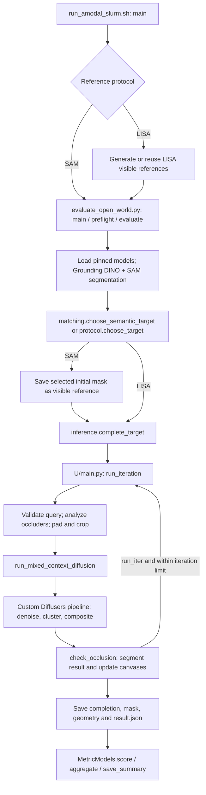

# Paper → Python file → function

This guide traces the source in this workspace and the pinned PD-MC checkout used by the runner. It is intended for setting breakpoints, diagnosing failed targets, and choosing where to make an experimental change.

## 1. Identify the method you are running

| Source | Role in this project | Read first |
| --- | --- | --- |
| [CS331_paper.pdf](../CS331_paper.pdf), *Amodal Completion via Progressive Mixed Context Diffusion* | The **PD-MC completion method** that runs during benchmark inference. | §3.4 / Fig. 2: progressive completion; §3.5 / Fig. 4: Mixed Context; Appendix A.1–A.2: implementation details. |
| [supplement_paper.pdf](../supplement_paper.pdf), *Open-World Amodal Appearance Completion* | The **dataset and evaluation protocol** used here; the experiment targets its PD-MC baseline in Table 3. Its own proposed completion method is a separate pipeline. | §4.1–4.2; Table 3 on PDF page 8; Table 5 on PDF page 11. |
| [open_world_main.py](../datasets/open_world_amodal/references/open_world_main.py) | Archived source for the open-world authors' own method. Useful for comparison; the local evaluator does **not** call this file. | See section 5 below. |
| [open_world_eva_amodal.py](../datasets/open_world_amodal/references/open_world_eva_amodal.py) | Archived evaluator used to reconstruct the local scoring operations. It is not imported during evaluation. | Compare its metric helpers with `MetricModels.score()`. |

**Path notation:** `U/` means the runner's actual upstream checkout, normally `CACHE_DIR/amodal`, or the directory supplied through `--repo-dir`. `U/main.py` is pinned to `k8xu/amodal@bfbfcdec581484586774d9ca53f5c603c97c725b`.

The local [pdmc_main.py snapshot](../datasets/open_world_amodal/references/pdmc_main.py) is byte-identical to that pinned `U/main.py`, with SHA-256 `eed6b9eefe6c8aff9ad3d14046c5df8c04b5bc79cfd8ef586e97e51456331c8e`. Its links below let you read the implementation locally. **Breakpoints for real inference belong in `U/main.py`; editing the archived snapshot does not change the running pipeline.** External links point to the same pinned revision, including its modified Diffusers source.

## 2. Follow the active execution path

The current configured baseline is `configs/baseline.json`, using semantic matcher v2 and SAM references. `configs/lisa-reference.json` selects the separate LISA protocol. The workflow CLI, snapshots, verification and registry are described in [README.md](../README.md); they surround the established inference implementation.



The diagram shows the successful path. Validation, target matching, or segmentation can stop a target earlier. Existing results can skip inference entirely. With multiple workers, the coordinator launches independent inference processes, then collects and scores their saved records.

There are two runner modes:

| Trigger | Actual route | Consequence for debugging |
| --- | --- | --- |
| `--benchmark-root ...` | [run_benchmark()][runner-benchmark] → local evaluator → [load_upstream()][load-upstream] → [complete_target()][complete-target] | Applies local boundary repair, backdrop sizing, target selection, diagnostics, and result bookkeeping. |
| Qualitative inputs without `--benchmark-root` | [run_pipeline()][runner-qualitative] → [launch_upstream()][runner-launch] → upstream `run_pipeline()` | Uses upstream's own target loop. The launcher changes the model source; it does not install the benchmark adapter's runtime hooks. |

### PD-MC component map

| Paper component | Python file | Function / method | Inputs → outputs; what to inspect |
| --- | --- | --- | --- |
| Pretrained auxiliary models, §3.1 / Appendix A | `U/main.py` | [load_models()][pdmc-models] | Checkpoint paths + MC timestep → Grounding DINO, diffusion, InstaOrder, LaMa. MC enabled selects the custom pipeline class. |
| Grounded instance segmentation, §3.4 | `U/main.py` | [transform_image()][pdmc-transform], [run_gdino()][pdmc-gdino], [run_sam()][pdmc-sam], [segment()][pdmc-segment] | PIL image + vocabulary → RGB image, instance masks, detected classes, confidence scores. Inspect detection before tuning diffusion. |
| Which annotated target to complete, benchmark adapter | `amodal_benchmark/protocol.py` | [choose_target()][choose-target] | Detected masks + label + optional reference mask → target index or rejection. This is a local adapter rule, not a paper-supplied PD-MC benchmark adapter. |
| Query eligibility, release behavior | `U/main.py` | [check_valid_query()][pdmc-valid] | Rejects low detector confidence, small masks, and classes outside the vocabulary. Returns query mask and **detected class**, which becomes the diffusion prompt. |
| Occluder analysis, §3.4 / Fig. 2 / Appendix A.1 | `U/main.py` → `U/InstaOrder/inference.py` | [analyze_masks()][pdmc-analyze] → [infer_order_sup_occ_depth()][insta-order] | RGB + instance masks → pairwise ordering → masks predicted to occlude the query. The release requests `pairs="all"` and selects from the transposed **occlusion-order** matrix; the returned depth matrix is unused here. |
| Unified occlusion mask, §3.4 | `U/main.py` | [aggregate_occluders()][pdmc-aggregate] | Occluder masks → binary union, with overlapping query pixels removed. This mask controls what diffusion may replace. |
| Boundary detection, Appendix A.1 | `U/main.py`; `amodal_benchmark/inference.py` | [check_touch_boundary()][pdmc-boundary], replaced by [paper_touch_boundary()][paper-boundary] in default benchmark mode | Mask → touched sides using a 10-pixel gap. Local `paper` mode repairs the released vertical min/max reversal; `released` mode preserves it. |
| Conditional padding and zoom, §3.4 / Appendix A.1 | `U/main.py` | [create_canvas()][pdmc-canvas], [find_crop_region()][pdmc-crop-region], [crop()][pdmc-crop] | Image and masks → centered 6× canvases → square crop. PD-MC uses crop buffer 60 and boundary padding 60. |
| One progressive pass, §3.4 / Eq. 3 | `U/main.py` | [run_iteration()][pdmc-iteration] | Query state + models → completion + updated state. Builds `sd_img`, `sd_modal_mask`, `sd_occ_mask`, and `sd_prompt`; dilates the inpainting mask with a 5×5 kernel, three iterations. |
| Repeated completion, §3.4 | `amodal_benchmark/inference.py` | [complete_target()][complete-target] | Calls upstream passes while `query.run_iter`; enforces the released inclusive maximum; packages the final output. |
| Mixed Context input preparation, §3.5 / Fig. 4 | `U/main.py` | [run_mixed_context_diffusion()][pdmc-mc] | Cropped image, modal mask, inpainting mask, prompt, gray backdrop → custom diffusion call. See the detailed sampler map below. |
| Re-segment generated object, §3.4 | `U/main.py` | [filter_out_amodal_segmentation()][pdmc-filter], [compute_iou()][pdmc-iou] | Generated mask candidates → candidate with greatest overlap with the previous modal mask. This matching is separate from initial benchmark target selection. |
| Detect remaining occlusion and update state, §3.4 | `U/main.py` | [check_occlusion()][pdmc-check-occlusion] | Generated image → new instance masks, amodal mask, occluder mask, canvas updates, and `run_iter`. Continues for remaining occluders or boundary contact. |
| Trim background / return object, §3.4 | `amodal_benchmark/inference.py`; `U/main.py` | [complete_target()][complete-target], [compute_offset()][pdmc-offset] | Saves JPEG RGB, binary mask, RGBA PNG, and row/column offset relative to the original image. RGB for the PNG is reloaded from the quality-90 JPEG. |
| Counterfactual completion curation, §3.6 / Fig. 5 / Appendix A.3 | No active implementation in the traced inference path | **No corresponding call** in `complete_target()` or `run_iteration()` | The paper's extra outpainting test uses boundary gap 2, 5×5 dilation for four iterations, and area ratio 1.2. `check_occlusion()` is the progressive stopping check, not this curation system. |

### Inside Mixed Context sampling

Let `P` denote `U/diffusers/src/diffusers/pipelines/stable_diffusion/pipeline_stable_diffusion_inpaint_mixed_context.py` and `N` denote `U/diffusers/src/diffusers/models/unet_2d_condition.py`.

| Paper step | Python file | Function / exact code location | Inspect |
| --- | --- | --- | --- |
| Swap context, §3.5 / Eq. 4 | `U/main.py` | [run_mixed_context_diffusion()][pdmc-mc] | Copies backdrop pixels outside the modal mask into `sd_img_syn`. |
| Remove objects, §3.5 / Eq. 5 | `U/lama/bin/predict_for_mc.py` | [run_lama_inpainter()][lama-inpaint], called by `run_mixed_context_diffusion()` | Uses the union of modal and occlusion masks. The caller subsequently restores visible query pixels in `object_removed_bkgd_img`. |
| Denoise synthetic context | `P` | [StableDiffusionInpaintMixedContextPipeline.__call__()][mc-call] | Check `timesteps`, `latents`, `mask`, `masked_image_latents`, and `mixed_context_timestep`. |
| Extract decoder features, Appendix A.2 | `N` | [UNet2DConditionModel.forward()][unet-forward]; [feature capture][unet-features] | `up_ft[2]`: third up block, zero-based. |
| Cluster conditioned features | `P` | [`__call__()` clustering branch][mc-clusters] | Takes the text-conditioned batch item; KMeans uses four clusters and `random_state=0`. |
| Align clusters to visible mask | `P` | [get_interm_query_mask()][mc-mask], nested inside `__call__()` | Retains clusters covering >20% of query-mask area, includes the modal mask, and clips to modal ∪ inpainting regions. |
| Noise original context | `P` | [get_noisy_latent()][mc-noisy-latent], nested inside `__call__()` | VAE-encodes the prepared background; adds noise at scheduler value `t`. |
| Composite, §3.5 / Eq. 6 | `P` | [swap_background_latent()][mc-swap], [get_noisy_image()][mc-noisy-image]; [call site][mc-composite] | Pastes query latents into background latents, then decodes and re-encodes the composite. |
| Continue denoising | `P` | [`__call__()` denoising loop][mc-denoise] | Changes masked-image conditioning after the swap; advances with `scheduler.step()`. |
| Oversized clean backdrop, local repair | `amodal_benchmark/inference.py` | [size_mixed_context_background()][size-background] | Enlarges the backdrop only when needed for indexed non-query pixels. It wraps the upstream preparation function. |

The nested sampler helpers are defined inside the swap branch; there is no top-level `get_interm_query_mask` to import. Use filename/line breakpoints there.

## 3. Benchmark, references, and metrics

| Paper / project component | Python file | Function | Data or artifact to inspect |
| --- | --- | --- | --- |
| Open-world selected dataset, §4.1 / Table 1 | `prepare_open_world.py`; `amodal_benchmark/dataset.py` | [import_release()][import-release], [download_metadata()][download-metadata], [download_originals()][download-originals], [import_laion()][import-laion] | Official annotation checksums and image acquisition provenance. The benchmark has 2,565 targets from 2,379 original images across four sources. |
| Annotation → original-image identity | `amodal_benchmark/dataset.py` | [target_record()][target-record], [read_official()][read-official] | `row`: ID, source, label, image path, reference path. Counts and checksums establish the exact selected subset. |
| Input/reference validation | `amodal_benchmark/dataset.py`; `evaluate_open_world.py` | [audit_files()][audit-files], [preflight()][preflight] | Missing/corrupt files, selected source/limit, reference provenance, effective target-selection policy. |
| LISA visible masks, open-world §3.1 / §4.2 | `amodal_benchmark/references.py` | [LisaSegmenter.__init__()][lisa-init], [LisaSegmenter.predict()][lisa-predict] | Input image + query → raw visible mask in original-image coordinates. Used for **reference generation and matching**, not as PD-MC's own segmentation model. |
| Reference crop and erosion, released open-world preprocessing | `amodal_benchmark/references.py` | [first_crop()][first-crop], [visible_rgba()][visible-rgba] | Raw mask → eroded reference alpha and crop geometry. Erosion: 5×5 once. Reference boundary padding is **150**, distinct from PD-MC's 60. |
| Reference persistence and reuse | `prepare_visible_references.py`; `amodal_benchmark/references.py` | [main()][prepare-references], [save_reference()][save-reference], [cached_reference()][cached-reference] | `masks/` keeps raw masks; `crops/` keeps released-style RGBA crops; `records/` keeps status, hashes, geometry, and provenance. |
| Seeds and orchestration, local implementation | `evaluate_open_world.py` | [seed_for()][seed-for], [set_seed()][set-seed], [evaluate()][evaluate] | Detection seed derives from image path; completion seed derives from target ID. The same image's targets share detection results when consecutive in a worker. |
| Experiment identity and resume | `amodal_benchmark/inference.py`; `amodal_benchmark/protocol.py` | [load_upstream()][load-upstream], [ensure_run_config()][ensure-config], [read_cached_result()][cached-result] | Checks upstream source hash, model/checkpoint identity, input hashes, reference identity, and saved output hashes. |
| CLIP relevance, open-world §4.2 / Table 3 | `amodal_benchmark/metrics.py` | [MetricModels.clip_score()][clip-score] | Raw ViT-B/32 image/text **logit** on the white-composited completion; label comes from the annotation. This differs from cosine similarity in the original PD-MC paper. |
| Appearance consistency, open-world §4.2 / Table 3 | `amodal_benchmark/metrics.py` | [MetricModels.score()][metric-score] | LPIPS AlexNet, VGG16 feature cosine similarity, and SSIM. Uses the reference's `alpha < 255` bounding rectangle, following the archived evaluator. |
| Optional original-frame alignment | `amodal_benchmark/protocol.py` | [align_rgba()][align-rgba], [white_rgb()][white-rgb] | Places crops using `geometry.offset_rc`, retaining outpainted pixels. The CLI default is `released` crop alignment; the helper's own default is `original-frame`. |
| Failed completion penalties, open-world discussion following Table 3 | `amodal_benchmark/protocol.py` | [failure_metrics()][failure-metrics] | LPIPS=1, VGG similarity=0, SSIM=0; CLIP remains null. Missing images and failed LISA references are tracked separately. |
| Reporting | `amodal_benchmark/protocol.py`; `evaluate_open_world.py` | [aggregate()][aggregate], [save_summary()][save-summary] | Per-source and overall metrics with individual denominators, status counts, failure reasons, CSV, JSON, and Markdown table. |
| Parallel inference, local infrastructure | `amodal_benchmark/parallel.py` | [partition_rows()][partition-rows], [plan_devices()][plan-devices], [run_workers()][run-workers], [output_lock()][output-lock] | One full PD-MC process per assigned GPU; all targets from one image stay together. Worker logs and execution metadata are under `workers/`. |
| LISA memory placement, local infrastructure | `amodal_benchmark/placement.py` | [plan_lisa_devices()][plan-lisa], [place_lisa_model()][place-lisa] | Splits LISA decoder blocks across visible GPUs, keeping fixed vision/segmentation modules on GPU 0. This differs from PD-MC's independent workers. |

The original PD-MC paper's pseudo-occlusion benchmark, DreamSim metric, human preference study, and curation accuracy experiment are not reproduced by this evaluator. The open-world appearance references contain visible evidence; they are not ground truth for hidden RGB pixels.

## 4. Debug one target from input to output

Start with the inexpensive input check:

```bash
python3 prepare_visible_references.py \
  --dataset-root ./datasets/open_world_amodal --check-only
```

Inside an existing GPU allocation, make a small run with one worker so that logs and breakpoints follow one process:

```bash
bash run_amodal_slurm.sh --local \
  --benchmark-root ./datasets/open_world_amodal \
  --benchmark-sources free_images --benchmark-limit 1 --benchmark-workers 1 \
  --cache-dir /scratch/$USER/amodal-cache \
  --output-dir ./output/pdmc-debug-one
```

For a debugger, invoke `evaluate_open_world.py` using the provisioned environment and the import paths from [configure_python_imports()][runner-imports]. Use absolute data/output paths: `evaluate()` changes the working directory to `U` before loading upstream. Choose a fresh output directory to step through inference; validated cached targets skip it. `--limit` selects the first N targets after source filtering, not a specific target ID.

Use the linked function definitions to set source breakpoints, in this order:

| Stop | Inspect | Expected relationship |
| --- | --- | --- |
| `evaluate()`, after `segment()` | `row`, `masks`, `classes`, `scores`, `selection_path` | `masks` has shape `(N,H,W)` in original-image coordinates. `len(classes) == len(scores) == N`. |
| `choose_target()` | `reference_alpha`, per-candidate IoUs, chosen index | Default reference matching uses the raw LISA mask, requires IoU ≥0.5, and chooses the first best match. |
| `complete_target()` | `query`, `target`, `vocabulary`, `max_iter` | `query.mask_id` indexes the selected PD-MC detection. Track `query.iter_id` and `query.run_iter`. |
| `U/main.py: run_iteration()` | `occ_mask`, `sides_touched`, cropped masks, `sd_prompt` | Occlusion/outpaint mask value 1 means replace pixels. Modal mask value 1 means visible query. Prompt is the detected class. |
| `U/main.py: run_mixed_context_diffusion()` | `sd_img_syn`, `object_removed_bkgd_img`, mask sizes | RGB arrays and masks share crop height/width before the pipeline preprocesses them. |
| `P: __call__()` at the clustering branch | `i`, `t`, `timesteps[mixed_context_timestep]`, `up_ft[2]` | MC setting is a zero-based index into the scheduler's decreasing timestep array, not the raw noise value `t`. |
| `P: get_interm_query_mask()` / compositing call site | `cluster_assignments`, `interm_query_mask`, `latents` | Intermediate mask matches latent spatial resolution and stays inside modal ∪ inpainting regions. |
| `U/main.py: check_occlusion()` | `amodal_segmentations`, chosen mask, new occluders, `run_iter` | Updates the query's canvases and decides whether another pass is needed. |
| `MetricModels.score()` | reference/prediction shapes, `alignment`, crop rectangle | Check geometry and alpha handling before interpreting a metric difference. |

`load_upstream()` compiles upstream with its real filename, so breakpoints in `U/main.py` preserve the original line numbers. Runtime hooks wrap several functions; stepping through `install_runtime_hooks()` may enter a local wrapper before reaching the upstream body.

### Read the saved trace before rerunning

For `OUTPUT/targets/SOURCE/TARGET/`:

| Artifact | What it tells you |
| --- | --- |
| `result.json` | Status, selection candidates/IoUs, detected class, seed, failure reason, geometry, and per-iteration diagnostics when an upstream iteration ran. |
| `completion.jpg` | Final generated RGB, including surrounding context. |
| `mask.png` | Binary final object mask. |
| `completion.png` | JPEG-derived RGB with the object mask as alpha. |
| `metrics.json` | Cached successful appearance/relevance scores and their input hashes. Failure penalties may appear only in combined reports. |

At the run root, inspect `run_config.json`, `metric_config.json` when scoring ran, `per_target.csv`, and `summary.json`. Worker logs are `workers/<execution-id>/worker-XX.log`.

Per-iteration diagnostics currently record boundary sides, eligibility measurements, and stop reason. They do **not** save occlusion masks, U-Net features, cluster assignments, latent composites, or an image for every pass. The benchmark passes `save_interm=False`; tracing those tensors requires a debugger or explicit experimental instrumentation.

| Symptom / recorded reason | First place to inspect |
| --- | --- |
| `reference_failed` | Reference `records/SOURCE/TARGET.json`: `empty_mask` versus `eroded_empty`; `LisaSegmenter.predict()` and erosion. |
| `not_detected` | `selection_diagnostics.reason`: no detections versus reference IoU below threshold; then `segment()` and `choose_target()`. |
| `ambiguous_target` | `choose_target()`: ambiguous labels or legacy strict reference matching. |
| `detector_score_below_threshold`, `query_mask_too_small`, `unknown_detected_class` | `check_valid_query()` and local eligibility diagnostics. Diffusion has not run for that rejected pass. |
| `no_occlusion_detected` | `analyze_masks()`, aggregated mask, boundary mode and touched sides. |
| `completion_not_detected` | Post-diffusion `segment()` inside `check_occlusion()`. |
| Success with `iteration_limit_reached=true` | A completion exists, but `run_iter` was still true at the cap. The status does not certify that the object is complete. |
| Wrong object or wrong prompt | Compare annotation label, selected mask, candidate IoUs, and detected class before investigating MC sampling. |
| Unexpected appearance scores | Compare raw reference mask with eroded alpha, released crop with original-frame alignment, and per-metric denominators. |

## 5. Locate the open-world paper's own method

These are **archived reference paths**, outside the active PD-MC benchmark call graph. They explain where the second paper's components appear in the available source without implying they run in this experiment.

| Open-world component | Archived Python file | Function / call site | Active local counterpart |
| --- | --- | --- | --- |
| LISA query interpretation, §3.1 | `references/open_world_main.py` | [run_pipeline()][ow-pipeline] calls the LISA Gradio service through `client.predict()`. | `LisaSegmenter.predict()` replaces that service for visible-reference generation only. |
| Image tags and grounded segmentation, §3.2 | `references/open_world_main.py` | `run_pipeline()` calls RAM++; [segment()][ow-segment] runs grounded segmentation. | PD-MC instead receives its pinned `classes.txt` vocabulary. |
| Occlusion analysis, §3.2 | `references/open_world_main.py` | [analyze_masks()][ow-analyze], [aggregate_occluders()][ow-aggregate], [handlemask()][ow-handlemask]. | PD-MC's original occlusion analysis. |
| Prompt refinement, §3.3 / Eq. 4 | `references/open_world_main.py` | [clip_similarity_w_query()][ow-prompt], called from `run_pipeline()`. | Absent from active PD-MC completion; it uses the detected class. |
| Clean context and iterative inpainting, §3.4 | `references/open_world_main.py` | [run_iteration()][ow-iteration], [check_occlusion()][ow-check-occlusion]. | PD-MC uses its separate custom MC diffusion path. |
| Seamless output blending, §3.4 / Eq. 8 | `references/open_world_main.py` | [img_blend()][ow-blend], [alpha_blending()][ow-alpha], [shrink_edges_to_transparent()][ow-shrink]. | Local PD-MC output attaches its predicted alpha to generated RGB; these blending functions are not called. |

Here `references/` abbreviates `datasets/open_world_amodal/references/`. The open-world paper describes an occluder-mask stability stopping criterion. The archived loop visibly checks `run_iter` and an iteration cap; establish its exact behavior from `check_occlusion()` before treating it as an implementation of that equation.

## 6. Paper/code differences and improvement locations

| Detail | Observed implementation | Where an experiment belongs |
| --- | --- | --- |
| Typical MC setting | Appendix A.2 favors timestep 20; this project's default is **35**, following released usage. The custom sampler indexes `timesteps[k]`. | `--mc-timestep`; `__call__()` swap condition. Use a separate output directory for each setting. |
| MC versus no-MC | Upstream selects ordinary inpainting when `mc_timestep is None`, but the local evaluator CLI accepts integers 0–49 only. **Zero does not disable MC.** | `load_models()`, `run_iteration()`, and evaluator argument handling if adding a controlled no-MC ablation. |
| Iteration maximum | Default `max_iter_id=5` can permit **six** diffusion passes because the check is `iter_id > max_iter` after a pass. | `complete_target()`; match upstream semantics when comparing against the baseline. |
| Progressive state | `check_occlusion()` updates canvases, but `run_iteration()` reads original `query_obj.img`, `query_obj.query_mask`, and the originally supplied detections again; crop bounds use `init_query_mask_canvas`. | Trace these objects across passes before changing state propagation or crop growth. This is a source observation, not a measured quality regression. |
| Neighbor/depth description | Paper describes neighboring objects and depth ordering; released `analyze_masks()` uses all pairs and selects predicted occlusion relations. | `analyze_masks()` and InstaOrder inference; changing neighbor filtering changes the baseline. |
| MC background description | Paper describes removing query + occluders; release pastes visible query pixels back into the LaMa result before sampling. | `run_mixed_context_diffusion()` when investigating visible-region preservation or context leakage. |
| Initial target matching | Default `auto` resolves to `reference-best` when references are present. Legacy `reference` rejects near ties within 0.05. | `choose_target()` and `preflight()`; keep annotation label and detected class distinct. |
| Boundary / large crops | Benchmark hooks repair vertical boundary coordinates and resize insufficient clean backdrops. Qualitative launch does not install these hooks. | `install_runtime_hooks()` and `size_mixed_context_background()`. |
| Completeness curation | The paper's counterfactual classifier is absent from the active call graph. | A separate explicit curation stage would be new functionality; existing `status="success"` means an output was saved. |
| Metric meaning | Open-world CLIP logits and visible-reference appearance metrics differ from the original PD-MC paper's metrics and hidden-part ground truth. | `MetricModels`, alignment protocol, `aggregate()`; compare only matching protocols and denominators. |

For method improvements, start at the earliest incorrect intermediate result: target mask → occluder mask → crop → MC segmentation → completion → final segmentation → scoring. Changing diffusion cannot repair a target that was rejected before sampling.

`load_upstream()` refuses a changed `U/main.py` hash. The runner also checks out its pinned commit during setup. To develop an upstream change, version it deliberately, update the relevant pin/hash and adapter configuration as needed, and use a new experiment output directory. Keep the archived baseline snapshots and existing experiment provenance available for comparison; do not silently bypass the resume guards.

## 7. Existing checks relevant to each component

| Area | Existing regression coverage |
| --- | --- |
| Upstream eligibility gates, boundary repair, iteration behavior | [test_inference_protocol.py](../tests/test_inference_protocol.py) |
| Oversized MC backdrop and unchanged supported crops | [test_mixed_context_background.py](../tests/test_mixed_context_background.py) |
| Dataset identity, target matching, penalties, geometry, resume | [test_open_world_benchmark.py](../tests/test_open_world_benchmark.py) |
| Visible-mask erosion, reference crops, raw-mask persistence, reference failures | [test_visible_references.py](../tests/test_visible_references.py) |
| LISA placement | [test_lisa_placement.py](../tests/test_lisa_placement.py) |
| Worker assignment, serial/parallel equivalence and result collection | [test_parallel_benchmark.py](../tests/test_parallel_benchmark.py), [test_parallel_evaluation.py](../tests/test_parallel_evaluation.py) |
| Config inheritance, provenance, independent artifact verification, registry and offline smoke | [test_project_workflow.py](../tests/test_project_workflow.py) |
| Semantic matcher and annotation-guided detector vocabulary | [test_semantic_matching.py](../tests/test_semantic_matching.py), [test_detection_vocabulary.py](../tests/test_detection_vocabulary.py) |
| Runtime source/import setup | [test_amodal_model_source.py](../tests/test_amodal_model_source.py), [test_amodal_import_paths.py](../tests/test_amodal_import_paths.py), shell regressions |
| Real GPU imports and compiled extension | [validate_pipeline_imports.sh](../tests/validate_pipeline_imports.sh), [validate_cuda_extension.sh](../tests/validate_cuda_extension.sh) |

CPU gate tests replace expensive model calls. They establish control flow and bookkeeping, not diffusion quality or real GPU correctness. Follow [OPEN_WORLD_REPRODUCTION.md](../OPEN_WORLD_REPRODUCTION.md) and [AMODAL_SLURM.md](../AMODAL_SLURM.md) for full run commands and cluster validation.

[runner-benchmark]: ../run_amodal_slurm.sh#L1231
[runner-qualitative]: ../run_amodal_slurm.sh#L1128
[runner-launch]: ../run_amodal_slurm.sh#L1090
[runner-imports]: ../run_amodal_slurm.sh#L971
[load-upstream]: ../amodal_benchmark/inference.py#L172
[complete-target]: ../amodal_benchmark/inference.py#L200
[paper-boundary]: ../amodal_benchmark/inference.py#L20
[size-background]: ../amodal_benchmark/inference.py#L138
[pdmc-models]: ../datasets/open_world_amodal/references/pdmc_main.py#L85
[pdmc-transform]: ../datasets/open_world_amodal/references/pdmc_main.py#L153
[pdmc-gdino]: ../datasets/open_world_amodal/references/pdmc_main.py#L166
[pdmc-sam]: ../datasets/open_world_amodal/references/pdmc_main.py#L201
[pdmc-segment]: ../datasets/open_world_amodal/references/pdmc_main.py#L227
[pdmc-valid]: ../datasets/open_world_amodal/references/pdmc_main.py#L246
[pdmc-analyze]: ../datasets/open_world_amodal/references/pdmc_main.py#L291
[pdmc-aggregate]: ../datasets/open_world_amodal/references/pdmc_main.py#L319
[pdmc-boundary]: ../datasets/open_world_amodal/references/pdmc_main.py#L359
[pdmc-canvas]: ../datasets/open_world_amodal/references/pdmc_main.py#L334
[pdmc-crop-region]: ../datasets/open_world_amodal/references/pdmc_main.py#L378
[pdmc-crop]: ../datasets/open_world_amodal/references/pdmc_main.py#L417
[pdmc-iteration]: ../datasets/open_world_amodal/references/pdmc_main.py#L562
[pdmc-mc]: ../datasets/open_world_amodal/references/pdmc_main.py#L514
[pdmc-filter]: ../datasets/open_world_amodal/references/pdmc_main.py#L436
[pdmc-iou]: ../datasets/open_world_amodal/references/pdmc_main.py#L425
[pdmc-check-occlusion]: ../datasets/open_world_amodal/references/pdmc_main.py#L453
[pdmc-offset]: ../datasets/open_world_amodal/references/pdmc_main.py#L499
[insta-order]: https://github.com/k8xu/amodal/blob/bfbfcdec581484586774d9ca53f5c603c97c725b/InstaOrder/inference.py#L349
[lama-inpaint]: https://github.com/k8xu/amodal/blob/bfbfcdec581484586774d9ca53f5c603c97c725b/lama/bin/predict_for_mc.py#L13
[mc-call]: https://github.com/k8xu/amodal/blob/bfbfcdec581484586774d9ca53f5c603c97c725b/diffusers/src/diffusers/pipelines/stable_diffusion/pipeline_stable_diffusion_inpaint_mixed_context.py#L975
[unet-forward]: https://github.com/k8xu/amodal/blob/bfbfcdec581484586774d9ca53f5c603c97c725b/diffusers/src/diffusers/models/unet_2d_condition.py#L834
[unet-features]: https://github.com/k8xu/amodal/blob/bfbfcdec581484586774d9ca53f5c603c97c725b/diffusers/src/diffusers/models/unet_2d_condition.py#L1199
[mc-clusters]: https://github.com/k8xu/amodal/blob/bfbfcdec581484586774d9ca53f5c603c97c725b/diffusers/src/diffusers/pipelines/stable_diffusion/pipeline_stable_diffusion_inpaint_mixed_context.py#L1391
[mc-mask]: https://github.com/k8xu/amodal/blob/bfbfcdec581484586774d9ca53f5c603c97c725b/diffusers/src/diffusers/pipelines/stable_diffusion/pipeline_stable_diffusion_inpaint_mixed_context.py#L1414
[mc-noisy-latent]: https://github.com/k8xu/amodal/blob/bfbfcdec581484586774d9ca53f5c603c97c725b/diffusers/src/diffusers/pipelines/stable_diffusion/pipeline_stable_diffusion_inpaint_mixed_context.py#L1467
[mc-noisy-image]: https://github.com/k8xu/amodal/blob/bfbfcdec581484586774d9ca53f5c603c97c725b/diffusers/src/diffusers/pipelines/stable_diffusion/pipeline_stable_diffusion_inpaint_mixed_context.py#L1485
[mc-swap]: https://github.com/k8xu/amodal/blob/bfbfcdec581484586774d9ca53f5c603c97c725b/diffusers/src/diffusers/pipelines/stable_diffusion/pipeline_stable_diffusion_inpaint_mixed_context.py#L1497
[mc-composite]: https://github.com/k8xu/amodal/blob/bfbfcdec581484586774d9ca53f5c603c97c725b/diffusers/src/diffusers/pipelines/stable_diffusion/pipeline_stable_diffusion_inpaint_mixed_context.py#L1504
[mc-denoise]: https://github.com/k8xu/amodal/blob/bfbfcdec581484586774d9ca53f5c603c97c725b/diffusers/src/diffusers/pipelines/stable_diffusion/pipeline_stable_diffusion_inpaint_mixed_context.py#L1348
[choose-target]: ../amodal_benchmark/protocol.py#L116
[white-rgb]: ../amodal_benchmark/protocol.py#L12
[align-rgba]: ../amodal_benchmark/protocol.py#L22
[failure-metrics]: ../amodal_benchmark/protocol.py#L40
[aggregate]: ../amodal_benchmark/protocol.py#L82
[ensure-config]: ../amodal_benchmark/protocol.py#L161
[cached-result]: ../amodal_benchmark/protocol.py#L173
[import-release]: ../prepare_open_world.py#L52
[download-metadata]: ../prepare_open_world.py#L62
[download-originals]: ../prepare_open_world.py#L92
[import-laion]: ../prepare_open_world.py#L129
[target-record]: ../amodal_benchmark/dataset.py#L37
[read-official]: ../amodal_benchmark/dataset.py#L62
[audit-files]: ../amodal_benchmark/dataset.py#L83
[preflight]: ../evaluate_open_world.py#L114
[seed-for]: ../evaluate_open_world.py#L194
[set-seed]: ../evaluate_open_world.py#L198
[evaluate]: ../evaluate_open_world.py#L368
[save-summary]: ../evaluate_open_world.py#L224
[lisa-init]: ../amodal_benchmark/references.py#L127
[lisa-predict]: ../amodal_benchmark/references.py#L178
[first-crop]: ../amodal_benchmark/references.py#L23
[visible-rgba]: ../amodal_benchmark/references.py#L62
[save-reference]: ../amodal_benchmark/references.py#L90
[cached-reference]: ../amodal_benchmark/references.py#L108
[prepare-references]: ../prepare_visible_references.py#L21
[clip-score]: ../amodal_benchmark/metrics.py#L30
[metric-score]: ../amodal_benchmark/metrics.py#L37
[partition-rows]: ../amodal_benchmark/parallel.py#L12
[plan-devices]: ../amodal_benchmark/parallel.py#L25
[run-workers]: ../amodal_benchmark/parallel.py#L70
[output-lock]: ../amodal_benchmark/parallel.py#L45
[plan-lisa]: ../amodal_benchmark/placement.py#L5
[place-lisa]: ../amodal_benchmark/placement.py#L61
[ow-pipeline]: ../datasets/open_world_amodal/references/open_world_main.py#L802
[ow-segment]: ../datasets/open_world_amodal/references/open_world_main.py#L269
[ow-analyze]: ../datasets/open_world_amodal/references/open_world_main.py#L348
[ow-aggregate]: ../datasets/open_world_amodal/references/open_world_main.py#L380
[ow-handlemask]: ../datasets/open_world_amodal/references/open_world_main.py#L1021
[ow-prompt]: ../datasets/open_world_amodal/references/open_world_main.py#L1185
[ow-iteration]: ../datasets/open_world_amodal/references/open_world_main.py#L616
[ow-check-occlusion]: ../datasets/open_world_amodal/references/open_world_main.py#L534
[ow-blend]: ../datasets/open_world_amodal/references/open_world_main.py#L1063
[ow-alpha]: ../datasets/open_world_amodal/references/open_world_main.py#L1099
[ow-shrink]: ../datasets/open_world_amodal/references/open_world_main.py#L1159
