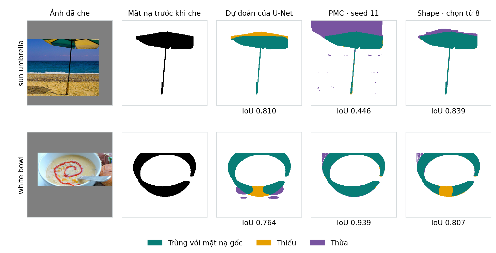
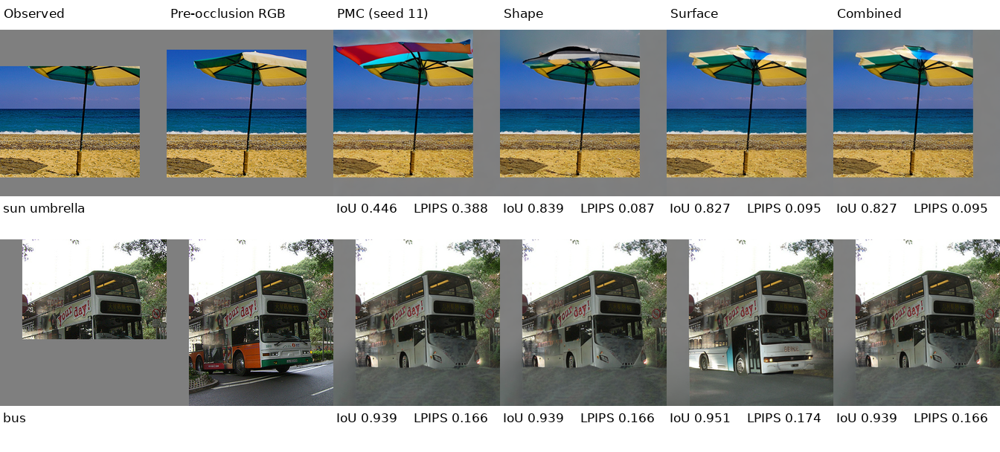
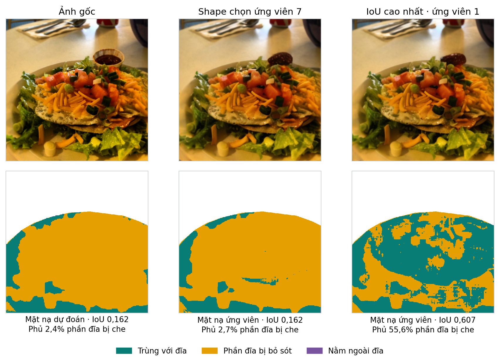
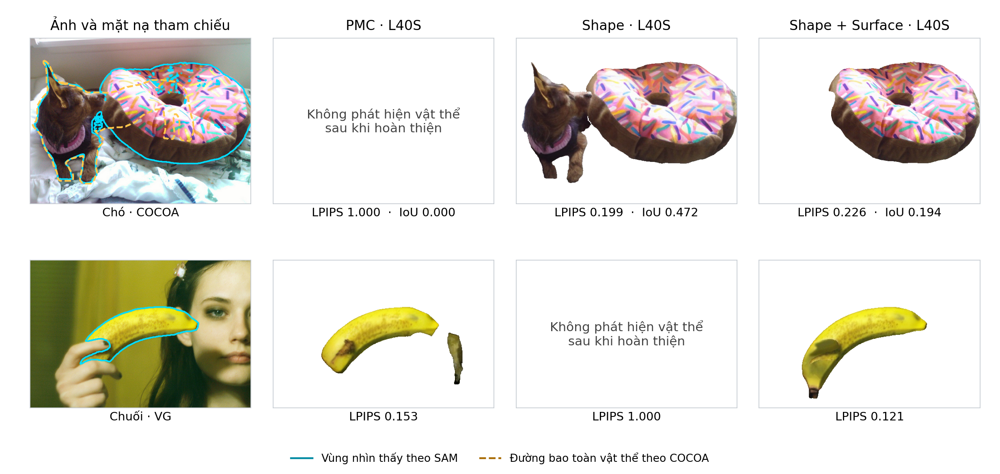

# Shape-Guided PMC · Week 8 report update

On the same 128 artificial occlusions used in the Week 8 presentation, choosing the candidate whose silhouette best matched the predicted shape raised mean mask IoU from 0.7142 to 0.7856. Object LPIPS fell from 0.1803 to 0.1532. The mean paired IoU gain was 0.0714 (95% interval 0.0566 to 0.0873).

Page numbers follow the 24-slide CS331 presentation checked on 22 November 2026. [Week 8 slides](https://www.canva.com/d/j8Vzc325LOrZKtc)

Trang 13–15 và 18 có thể dùng phương pháp Shape và quy tắc kết hợp đã triển khai. Hai ví dụ chiếc ô và xe buýt ở trang 21 đã có ảnh cho cả bốn phương pháp. Trang 22 có kết quả chọn ảnh trên cùng tám ứng viên cho từng ảnh trong tập kiểm tra 128 ảnh. Bảng 2.565 đối tượng ở trang 19 và biểu đồ theo mức che khuất ở trang 20 dùng kết quả đã xác minh của từng lượt chạy đầy đủ.

## Slide 22 · Equal-budget ablation

Trên 128 ảnh che nhân tạo, mỗi bộ chọn K=8 dùng cùng tám ứng viên PMC cho từng ảnh. So với chọn ngẫu nhiên đều, Shape nâng IoU với mặt nạ SAM trước khi che từ 0,7142 lên 0,7856 và giảm LPIPS vật thể từ 0,1803 xuống 0,1532. Hàng chọn ngẫu nhiên lấy trung bình cả tám kết quả. Hàng oracle dùng mặt nạ trước khi che để chọn ứng viên có IoU cao nhất khi đánh giá.

| Selector | K | Mask IoU ↑ | Hidden IoU ↑ | Object LPIPS ↓ | Hidden spatial LPIPS ↓ | Object DreamSim ↓ | Hidden RGB MAE ↓ |
|---|---:|---:|---:|---:|---:|---:|---:|
| PMC, seed 11 | 1 | 0.7247 | 0.5035 | 0.1762 | 0.4275 | 0.1643 | 0.1745 |
| PMC, uniform | 8 | 0.7142 | 0.4836 | 0.1803 | 0.4297 | 0.1701 | 0.1735 |
| Shape | 8 | 0.7856 | 0.5818 | 0.1532 | 0.4167 | 0.1383 | 0.1677 |
| Surface | 8 | 0.7684 | 0.5596 | 0.1599 | 0.4022 | 0.1415 | 0.1602 |
| Shape + Surface | 8 | 0.7827 | 0.5823 | 0.1556 | 0.4094 | 0.1406 | 0.1620 |
| Oracle shape | 8 | 0.8170 | 0.6527 | 0.1426 | 0.4074 | 0.1337 | 0.1643 |
| PMC, uniform | 4 | 0.7128 | 0.4864 | 0.1814 | 0.4300 | 0.1711 | 0.1755 |
| Shape | 4 | 0.7785 | 0.5865 | 0.1584 | 0.4194 | 0.1454 | 0.1697 |
| Shape with visible recall and leakage terms | 4 | 0.7825 | 0.5871 | 0.1563 | 0.4237 | 0.1431 | 0.1710 |
| Oracle shape | 4 | 0.7943 | 0.6173 | 0.1516 | 0.4159 | 0.1411 | 0.1708 |
| Shape with visible recall and leakage terms | 8 | 0.7885 | 0.5817 | 0.1517 | 0.4197 | 0.1368 | 0.1691 |

Adding the Shape rank to Surface on the same eight candidates increased mask IoU by 0.0143 (nominal 95% interval 0.0048 to 0.0242) and hidden-region IoU by 0.0228 (0.0025 to 0.0440). Object LPIPS fell by 2.71% (0.12% to 5.19%). CLIP text cosine also fell, from 0.2937 to 0.2912. All four comparisons use the selected raw RGB images and their candidate masks. [Paired ablation estimates](controlled-comparisons.csv)

The chat proposal specifies four candidates. On the same 128 images, Shape gained 0.0657 mask IoU over uniform K=4 (nominal 95% interval 0.0515 to 0.0813). Hidden-region LPIPS fell from 0.4300 to 0.4194. The K=4 oracle row shows the maximum silhouette IoU available in those four candidates.

**What the predicted hidden silhouette adds.** In this post hoc comparison, the control selects the candidate with the highest IoU against the visible mask alone. Shape adds its predicted hidden pixels to that mask. Both rules see the same candidates, exclude empty masks and break ties by seed order. Each cell gives the paired change and nominal 95% interval. The first three metrics use all 128 images. The last uses the 32 images with independent COCOA outlines.

| K | Changed selections (of 128) | Mask IoU gain | Hidden IoU gain | Object LPIPS reduction | COCOA amodal IoU gain |
|---:|---:|---:|---:|---:|---:|
| 4 | 81 | +0.0474 [+0.0323, +0.0634] | +0.1544 [+0.1129, +0.1966] | +0.0050 [-0.0001, +0.0101] | +0.0501 [+0.0180, +0.0919] |
| 8 | 89 | +0.0707 [+0.0515, +0.0903] | +0.2225 [+0.1739, +0.2727] | +0.0150 [+0.0091, +0.0212] | +0.0744 [+0.0412, +0.1101] |

With eight candidates, mean IoU inside the artificial occluder rose from 0.3593 using the visible mask alone to 0.5818 using the learned prior. [Selections, native mask digests and paired estimates](controlled-visible-ablation.json)

A supplemental DreamSim measurement retains the known hidden-core RGB and fills all other pixels with gray in both images. The CPU evaluation uses the frozen candidates and selections.

| Selection | K | Uniform hidden DreamSim ↓ | Selected hidden DreamSim ↓ | Absolute reduction (nominal 95% interval) |
|---|---:|---:|---:|---:|
| Shape | 4 | 0.2236 | 0.2053 | +0.0183 [+0.0099, +0.0270] |
| Shape | 8 | 0.2234 | 0.2077 | +0.0157 [+0.0059, +0.0254] |
| Surface | 8 | 0.2234 | 0.2008 | +0.0226 [+0.0143, +0.0308] |
| Shape + Surface | 8 | 0.2234 | 0.2045 | +0.0189 [+0.0092, +0.0279] |

[Hidden-core scores for every candidate and paired intervals](hidden-dreamsim.json)

Shape reduced object LPIPS by 15.07% against uniform selection (95% interval 12.10% to 18.11%). Against Surface, Shape gained 0.0172 mask IoU (0.0031 to 0.0316) and reduced object LPIPS by 4.22% (0.43% to 8.02%). Surface had lower hidden RGB MAE and higher text cosine. The combined rule had the highest hidden IoU among the three deployable K=8 selectors. Its 0.0006 lead over Shape is a point estimate.

Each interval uses 5,000 paired, source-stratified image bootstrap draws and is nominal. The two sources contribute 64 images each. All 128 images and all eight seeds enter the comparison. Nine candidate masks were empty. Every pool retained an eligible candidate.

### Controlled images with COCOA amodal outlines

Independent full-object outlines were available for 32 of the 128 controlled images. In 23 of these, COCOA marked part of the object as hidden before the artificial occlusion was added. The original pre-occlusion SAM masks, mapped back from the crops, had mean IoU 0.6826 with the COCOA outlines.

This post hoc comparison scores the saved candidate masks against those outlines across the original image frame, including annotated pixels outside each crop. Each row uses the same candidates for the selector and its uniform control.

| Selector | K | Uniform IoU | Selected IoU | Paired difference (nominal 95% interval) |
|---|---:|---:|---:|---:|
| Shape | 4 | 0.6328 | 0.6732 | +0.0405 [+0.0203, +0.0640] |
| Shape | 8 | 0.6357 | 0.6740 | +0.0384 [+0.0154, +0.0631] |
| Surface | 8 | 0.6357 | 0.6626 | +0.0270 [+0.0017, +0.0538] |
| Shape + Surface | 8 | 0.6357 | 0.6712 | +0.0355 [+0.0162, +0.0581] |

On the same eight candidates per image, the paired differences in mean amodal IoU versus Surface were +0.0114 for Shape (-0.0101 to +0.0363) and +0.0086 for Shape + Surface (-0.0091 to +0.0284). Parentheses give nominal 95% intervals.

[Matched targets, candidate scores and annotation provenance](controlled-cocoa.json)

For the four-candidate experiment in the proposal, PMC seed 11 reached 0.6333 mean amodal IoU on these 32 images. Uniform selection scored 0.6328 and Shape scored 0.6732. Choosing the highest-IoU candidate separately for each image gave 0.6968. This oracle reads the COCOA outline during evaluation and measures the best silhouette present in each four-candidate pool.

Trên cùng 32 ảnh COCOA, mỗi ảnh dùng bốn ứng viên. Cột đối chứng lấy trung bình bốn ứng viên của từng ảnh. Hai chỉ số đo độ sai khác với màu và họa tiết gốc ở phần vật thể bị che nhân tạo. Giá trị thấp hơn là tốt hơn.

| Chỉ số | Đối chứng K=4 | Shape K=4 | Mức giảm (KTC 95% danh nghĩa) |
|---|---:|---:|---:|
| LPIPS | 0,4329 | 0,4186 | +0,0143 (-0,0007 đến +0,0302) |
| DreamSim | 0,2224 | 0,2040 | +0,0184 (+0,0062 đến +0,0313) |

Shape tăng IoU với đường bao toàn vật thể và giảm DreamSim trên phần che nhân tạo. Mức giảm LPIPS còn chưa chắc chắn vì khoảng tin cậy bao gồm 0. [Đường bao và điểm IoU](controlled-cocoa.json) · [Điểm DreamSim theo ứng viên](hidden-dreamsim.json)

Of the 32 matched objects, 9 had zero annotated occlusion before the artificial mask was applied. Among those, 7 had an outline touching the original image border. We required identical visible and amodal annotations, an outline clear of the image border, and an input crop containing the outline. 2 objects met these conditions. The table gives original-frame amodal IoU for each eligible object.

| COCOA target | PMC seed 11 | Uniform K=4 | Shape K=4 | Polygon oracle K=4 | Uniform K=8 | Shape K=8 | Surface K=8 | Combined K=8 |
|---|---:|---:|---:|---:|---:|---:|---:|---:|
| COCO_train2014_000000020601_bowl | 0.5403 | 0.5767 | 0.5669 | 0.6414 | 0.5833 | 0.4500 | 0.5584 | 0.5584 |
| COCO_train2014_000000248755_cat | 0.6587 | 0.6450 | 0.6585 | 0.6587 | 0.6395 | 0.6585 | 0.6363 | 0.6363 |

The sample is too small to estimate how Shape performs on fully visible objects in general. [COCOA annotation masks](geometry.tar.gz) · [Frozen candidate scores](controlled-cocoa.json)

#### Occlusion in the controlled COCOA crops

For each input crop, we counted annotated amodal pixels that were already hidden or fell under the added occluder. The denominator is the annotated object area inside the crop. The scores below are mean amodal IoU in the original image frame. Each method uses the same four candidates per image.

| Hidden in the input crop | Images | Uniform K=4 | Shape K=4 |
|---|---:|---:|---:|
| 0–20% | 3 | 0.5914 | 0.5847 |
| 20–40% | 14 | 0.6693 | 0.7189 |
| 40–60% | 11 | 0.6644 | 0.6848 |
| 60–80% | 4 | 0.4490 | 0.5477 |
| 80–100% | 0 | — | — |

Only 4 images had at least 60% of the annotated object hidden in the crop. The groups are descriptive and combine natural and artificial occlusion. [Controlled crop and occluder records](../surface-confirmation128-20261110/cases.json) · [Original-frame IoU scores](controlled-cocoa.json)

Trong 9 ảnh COCOA có từ 50% đến 80% diện tích vật thể bị che trong khung đầu vào, IoU trung bình với đường bao toàn vật thể là 0,5682 khi chọn đều từ bốn ứng viên và 0,6192 khi dùng Shape. Shape vượt mức trung bình của bốn ứng viên ở 6/9 ảnh. Trước khi che nhân tạo, 8 vật thể đã bị che một phần và 1 vật thể chạm biên ảnh. Số ca trong nhóm này đáp ứng đủ tiêu chí nhìn thấy toàn bộ vật thể và nằm trọn trong khung là 0/9.

## Slides 13–15 and 18 · Geometry signal and integration

We implemented the five-channel U-Net and IoU selector from section 2 of the saved discussion, *Người 1 — Shape-Guided PMC*. The predicted mask scored 0.8122 mean IoU against the 128 pre-occlusion masks and 0.5716 within the hidden region.

**Trang 15 · Ba quyết định của Shape**

- **Tín hiệu hình học.** U-Net nhận ảnh RGB đã che, mặt nạ phần thấy của vật thể và mặt nạ vùng che. Mô hình giữ phần thấy và chỉ dự đoán thêm trong vùng che.
- **Tích hợp vào PMC.** Ở mỗi lượt, Shape chọn ảnh có mặt nạ vật thể không rỗng đạt IoU cao nhất với mặt nạ dự đoán. PMC dùng ảnh đã chọn cho lượt sau nếu vật thể vẫn bị che.
- **Đánh giá.** Trên 128 ảnh che nhân tạo, so sánh các bộ chọn trên cùng tám ứng viên bằng IoU với mặt nạ trước khi che và LPIPS với ảnh vật thể gốc. Với ảnh tự nhiên, đo IoU trên 321 đối tượng có đường bao toàn vật thể của COCOA.

The development oracle gained 0.0721 mean IoU over uniform K=4 on the 183 historical Surface development objects. We then trained only the auxiliary U-Net using those objects, rotated and flipped crops, 20–80% artificial occlusion, 40 epochs and BCE + Dice + 0.2 visible-retention loss. Image identities and source hashes are disjoint from the 128 confirmation images. The PMC generator and the Surface ranker stayed frozen.

**Trang 18 · Quy tắc chọn chung.** Trong mỗi nhóm ứng viên hợp lệ, Shape xếp IoU từ cao xuống thấp, còn Surface xếp điểm mất mát từ thấp lên cao. Hai tiêu chí có trọng số bằng nhau. Chọn ứng viên có tổng thứ hạng nhỏ nhất. Khi tổng hạng bằng nhau, lấy seed đứng trước. Nếu cả nhóm không có ứng viên hợp lệ, dùng ảnh từ seed đầu tiên.

The 128-image experiment returns the selected raw RGB. Both the four-seed source comparison and the eight-seed slide comparison use these same rules. The weighted variant uses the chat’s 0.60 IoU + 0.25 visible recall − 0.15 leakage formula as a secondary comparison.

Shape and Surface chose the same candidate on 23 of 128 images. On the 105 disagreements, the combined rule chose Shape’s candidate 34 times, Surface’s 45 times and a third candidate 26 times. Seed order decided 36 ties for the best combined rank. On these 105 images, mean mask IoU was 0.7963 for Shape, 0.7754 for Surface and 0.7928 for combined. Mean hidden-core RGB error was 0.1699, 0.1607 and 0.1629, respectively. These descriptive averages use the saved candidates from the controlled experiment.

The progressive implementation projects the original observed image, visible support, initial occluders and outpaint area into the current crop on every pass. It uses the Surface seed derivation and target-specific DINO/SAM resegmentation. Shape returns raw RGB. The combined progressive arm applies the frozen Surface RGB correction and native visible-pixel restoration to its jointly selected candidate. The released occlusion check determines whether to continue.

Shape beat the expected uniform IoU on 107 of 128 images and lost on 21. The umbrella comes from slide 21. The white bowl is the largest IoU loss versus uniform selection, chosen after evaluation to illustrate a failure. Its U-Net prior reached IoU 0.764. Shape selected a candidate with IoU 0.807 from a pool averaging 0.899, while seed 11 reached 0.939.

## Slide 21 · Matched qualitative examples

Ở ảnh chiếc ô, Shape chọn seed 44. So với PMC dùng seed 11, IoU với mặt nạ trước khi che tăng từ 0,446 lên 0,839 và LPIPS vật thể giảm từ 0,388 xuống 0,087. Shape + Surface chọn cùng ảnh với Surface (seed 33). [Kết quả từng ứng viên của ảnh chiếc ô](controlled/VG-020-2beacd8b40/result.json)

Ở ảnh xe buýt, Shape và Shape + Surface đều chọn seed 11 nên cho cùng kết quả với PMC. Surface chọn seed 55, có IoU cao hơn (0,951 so với 0,939) và LPIPS vật thể cao hơn (0,174 so với 0,166). LPIPS thấp hơn biểu thị ảnh gần với vật thể gốc hơn. [Kết quả từng ứng viên của ảnh xe buýt](controlled/VG-007-23ffa2bcf0/result.json)

## Slides 19–20 · Natural-image evaluation

The 128-image experiment hides about 35% of an originally visible SAM region. Its shape target is the silhouette before that artificial occlusion. Naturally hidden geometry, heavy occlusion and full progressive compute cost require separate measurements. Direct comparison with the CVPR paper requires its 3,000-case COCO/Open Images test set.

For natural images, LPIPS and SSIM compare the saved completion with a crop of the original photograph showing the object through its eroded SAM mask. The evaluator places both on white backgrounds, so a correctly reconstructed hidden part can still differ from white in the reference. A failed completion receives LPIPS 1 and SSIM 0. [Appearance scoring protocol](../../OPEN_WORLD_REPRODUCTION.md)

Trên 204 đối tượng, nhóm dùng lại kết quả PMC đã chạy trên L40S. Trên 2.565 đối tượng, hai đối chứng PMC và Surface dùng kết quả đã đăng ký trên Quadro RTX 6000. PMC dùng một ứng viên mỗi bước, còn Surface, Shape và Shape + Surface dùng tám. Hai phương pháp trên L40S dùng chung mặt nạ tham chiếu, danh sách nhãn, seed, điểm phạt và quy tắc dừng. Chênh lệch so với Quadro còn có thể phụ thuộc vào phần cứng, phần mềm lấy mẫu và khác biệt ở một số mặt nạ tham chiếu. Tập 2.017 đối tượng chưa thấy loại các ảnh từng dùng trong thí nghiệm có kiểm soát.

A separate geometry measure compares final masks with external COCOA amodal polygons for 321 uniquely matched targets. We map the output into the original image using its saved offset, score inside the annotated frame and assign IoU zero when completion fails. Occlusion-bin comparisons are descriptive. The severe 80–100% bin includes four targets in the full inventory.

The full benchmark includes 211 targets from images used to train Shape. For the frozen unseen analysis, we compared 1,910 source files from 1,900 image IDs with all 477 earlier study images, including the 183 Shape training images. Identity and file-hash checks found 0 shared IDs and 0 shared file hashes. Decoded pixels and aligned thumbnails flagged 0 unseen targets across studies. The screen can miss crops and transformations. Within the unseen subset, identical decoded pixels occur under laion/000012449 and laion/000002103. The bootstrap groups targets by the original image IDs. [Source-image overlap audit](unseen-image-audit.json)

The native reference audit found 38 of 204 Quadro/L40S cohort masks differed across 212 pixels in total. Crop geometry changed on 0 targets. The cropped RGBA image used for appearance scoring matched byte for byte on 174 targets. [Reference audit](reference-drift-cohort.json)

On the 204 frozen targets, the two existing PMC runs scored 0.6853 failure-inclusive LPIPS on Quadro (87 saved) and 0.6893 on L40S (86 saved). The estimated L40S relative gain was -0.58% (nominal 95% interval -1.85% to +0.16%). On the 166 targets from 159 images with byte-identical raw SAM masks, full RGBA images and crops, mean LPIPS was 0.729226 for PMC on L40S and 0.729470 for PMC on Quadro. The relative gain for the L40S run was +0.033% (nominal 95% interval -0.173% to +0.281%). The comparison includes all runtime differences between these two runs. [PMC cohort comparison](pmc-cohort-cross-device.json)

One COCOA dog (train image 108113) accounts for 97.1% of the observed mean LPIPS gap between the two PMC runs. Both initially selected the same dog bounding box at a detector score of 0.36. Their raw masks differed by one pixel. Their LPIPS scoring crops matched byte for byte. Quadro saved a completion with LPIPS 0.208432. On L40S, completion segmentation returned an empty mask array on the first iteration, so the target received the failure score of 1.0. It contributed 0.003880 to the 0.003997 mean difference across 204 targets. The cause of the empty mask array remains undetermined. [Quadro trace](../surface-annotated-20261112-freshrefs/baseline-cohort/targets/COCOA/COCO_train2014_000000108113_dog/result.json) · [L40S trace](progressive-l40s/baseline-cohort/targets/COCOA/COCO_train2014_000000108113_dog/result.json) · [Mask comparison](reference-drift-cohort.json)

On 59 cohort targets, historical Surface on Quadro and Shape on L40S had identical scoring references, first-pass crops, visible masks and seeds. Of the 472 corresponding raw candidate pairs, 0 had identical RGB pixels and 4 had identical candidate masks. The mean absolute difference across RGB channel values was 0.584 on a 0–255 scale. These differences arose before candidate selection. The two runs also used different sampling wrappers, so this comparison cannot isolate a GPU effect. [First-pass pixel comparisons](first-pass-cross-device-cohort.json)

Across 321 matched COCOA targets, historical PMC and Surface scored 0.4627 and 0.4644 mean amodal IoU. The paired difference was +0.0017 (nominal 95% interval -0.0139 to +0.0169). The CPU audit placed each saved completion’s alpha mask in the original image and assigned zero IoU to failed completions. [Per-target geometry and severity groups](cocoa-historical-controls.json)

In the 80–100% occlusion group, both historical methods completed the same two of four targets. The plate in COCO train image 060172 accounts for 0.2042 of the 0.2075 decrease in mean amodal IoU from PMC to Surface. Its individual IoU fell from 0.9809 to 0.1641. The other saved target was an elephant. [Four target records](cocoa-historical-controls.json)

Trên chiếc đĩa ở ảnh COCO train 060172, Shape (L40S) đạt IoU 0,2061 với đường bao toàn vật thể. Trong phần đĩa được chú thích là bị che, mặt nạ kết quả phủ 16.673 trên 222.997 pixel (7,48%). [Mặt nạ của Shape](progressive-l40s/shape/targets/COCOA/COCO_train2014_000000060172_plate/completion.png) · [Chú thích COCOA](evaluation_only/cocoa/COCO_train2014_000000060172_plate.png)

Ở lượt đầu của ca này, toàn bộ vùng mà mặt nạ dự đoán có thể phủ chỉ chứa 4,36% phần đĩa bị che. Mặt nạ U-Net thực tế phủ 2,35%. Trong 8 ứng viên, Shape chọn ảnh số 7, có IoU 0,162 với đường bao toàn đĩa. Ảnh số 1 đạt IoU 0,607 và phủ 55,6% phần đĩa bị che. Ứng viên này có trong cùng lượt sinh. Đường bao COCOA chỉ dùng để chấm sau khi chọn. [Điểm của từng ứng viên qua các lượt](shape-plate-trace.json)

### 204 natural targets

| Method | GPU | K per pass | Failure-inclusive LPIPS ↓ | SSIM ↑ | Saved | GPU-hours allocated |
|---|---|---:|---:|---:|---:|---:|
| PMC | L40S | 1 | 0.689272 | 0.350671 | 86 | 1.404 |
| Shape | L40S | 8 | 0.697381 | 0.344676 | 86 | 7.326 |
| Shape + Surface | L40S | 8 | 0.683841 | 0.355981 | 87 | 7.332 |
| Surface | Quadro RTX 6000 (historical) | 8 | 0.683564 | 0.356430 | 87 | 7.304 |

The Surface row reuses job 39487 on the same 204 targets. Comparisons with the L40S rows are cross-device. Raw masks, full RGBA images and crops were all byte-identical on 166 targets. [Historical Surface scores](../surface-annotated-20261112-freshrefs/surface-cohort/per_target.csv) · [Surface allocation](../surface-annotated-20261112-freshrefs/report/cohort-compute.json)

GPU-hours use elapsed Slurm allocation time on four GPUs of the stated type. Full totals include reused cohort work and interrupted allocations. [Historical cost accounting](../surface-annotated-full-review-20261114/REPORT.md)

Shape relative LPIPS difference versus PMC was -1.176% (nominal 95% interval -3.083% to +0.622%, positive favors shape).

At eight seeds per pass, shape scored 0.697381 LPIPS on L40S and the published Surface cohort scored 0.683564 on Quadro. The cross-device relative gain was -2.021% (nominal 95% interval -3.719% to -0.865%). On the 166 targets from 159 images with byte-identical raw SAM masks, full RGBA images and crops, mean LPIPS was 0.742182 for Shape on L40S and 0.728435 for Surface on Quadro. The relative gain for the L40S run was -1.887% (nominal 95% interval -3.873% to -0.616%).

On 22 COCOA targets from 20 images, Shape scored 0.2631 mean amodal IoU versus 0.2302 for PMC. The absolute difference was +0.0329 (nominal 95% interval +0.0034 to +0.0832).

Trên 22 đối tượng COCOA thuộc 20 ảnh, IoU trung bình của Shape trên L40S là 0,2631 và của Surface trên Quadro RTX 6000 là 0,2676. Chênh lệch giữa hai lượt chạy là -0,0045 (KTC 95% từ -0,0167 đến +0,0075). Cả hai dùng tám ứng viên mỗi bước. Mỗi ca không lưu được kết quả nhận IoU bằng 0. [Điểm Surface theo từng đối tượng](cocoa-historical-controls.json)

Shape recorded 158 eight-candidate passes (1,264 candidate images). In 2 of those passes, no candidate qualified and the selector used the first seed.

[Paired target scores](shape-cohort-vs-pmc-pairs.json) · [Estimates and intervals](shape-cohort-vs-pmc-summary.json)

Combined relative LPIPS difference versus PMC was +0.788% (nominal 95% interval -0.099% to +2.102%, positive favors combined).

At eight seeds per pass, combined scored 0.683841 LPIPS on L40S and the published Surface cohort scored 0.683564 on Quadro. The cross-device relative gain was -0.041% (nominal 95% interval -0.300% to +0.201%). On the 166 targets from 159 images with byte-identical raw SAM masks, full RGBA images and crops, mean LPIPS was 0.727955 for Shape + Surface on L40S and 0.728435 for Surface on Quadro. The relative gain for the L40S run was +0.066% (nominal 95% interval -0.109% to +0.267%).

On 22 COCOA targets from 20 images, Shape + Surface scored 0.2482 mean amodal IoU versus 0.2302 for PMC. The absolute difference was +0.0180 (nominal 95% interval +0.0040 to +0.0384).

Trên 22 đối tượng COCOA thuộc 20 ảnh, IoU trung bình của Shape + Surface trên L40S là 0,2482 và của Surface trên Quadro RTX 6000 là 0,2676. Chênh lệch giữa hai lượt chạy là -0,0194 (KTC 95% từ -0,0564 đến +0,0005). Cả hai dùng tám ứng viên mỗi bước. Mỗi ca không lưu được kết quả nhận IoU bằng 0. [Điểm Surface theo từng đối tượng](cocoa-historical-controls.json)

Shape + Surface recorded 150 eight-candidate passes (1,200 candidate images). In 1 of those passes, no candidate qualified and the selector used the first seed.

[Paired target scores](combined-cohort-vs-pmc-pairs.json) · [Estimates and intervals](combined-cohort-vs-pmc-summary.json)

Each cell gives the number of targets and their contribution to the mean LPIPS difference across all 204 targets. Positive values favor the method in the first column.

| Method | Comparator | Both saved | Only method saved | Only comparator saved | Both failed |
|---|---|---:|---:|---:|---:|
| Shape | PMC | 85 (-0.007881) | 1 (+0.003926) | 1 (-0.004154) | 117 (+0.000000) |
| Shape + Surface | PMC | 86 (+0.001638) | 1 (+0.003793) | 0 (+0.000000) | 117 (+0.000000) |
| Shape + Surface | Shape | 86 (+0.009233) | 1 (+0.004306) | 0 (+0.000000) | 117 (+0.000000) |

#### Shape and Shape + Surface on the same L40S inputs

LPIPS, VGG feature similarity and SSIM include every target with the frozen failure penalties. CLIP uses targets with a score from both methods. Positive relative gains favor Shape + Surface. Each interval uses 5,000 paired bootstrap draws of images within each data source.

| Metric | Paired targets | Shape | Shape + Surface | Relative gain | Nominal 95% interval |
|---|---:|---:|---:|---:|---:|
| LPIPS ↓ | 204 | 0.697381 | 0.683841 | +1.941% | [+0.807%, +3.568%] |
| VGG feature similarity ↑ | 204 | 0.272551 | 0.285201 | +4.641% | [+2.078%, +8.472%] |
| SSIM ↑ | 204 | 0.344676 | 0.355981 | +3.280% | [+1.118%, +6.653%] |
| CLIP ↑ | 86 | 28.285629 | 28.251622 | -0.120% | [-0.927%, +0.692%] |

Shape + Surface used 1.001 times the L40S GPU-hours of Shape across these 204 targets. The two methods ran 150 and 158 eight-candidate sampling passes, respectively.
Among the 86 targets where both methods saved outputs, mean LPIPS was 0.282159 for Shape and 0.260258 for Shape + Surface.

An independent local calculation reproduced the paired intervals from 5,000 image-cluster bootstrap samples stratified by source. [Local cohort replay](cohort-local-replay.json)

On the first pass, 87 targets had identical seeds, crops, saved prior inputs, predicted masks and all eight candidate image/mask pairs in both methods. The joint rule selected a different candidate on 49 of these targets. Neither method sampled a first candidate pool on 117 of 204 targets. Subsequent passes use each method’s selected image.
Across the 22 COCOA polygon matches, combined minus Shape amodal IoU was -0.0150 (nominal 95% interval -0.0459 to +0.0020).

Với chiếc giường trong ảnh COCO 009199, LPIPS giảm từ 0,4617 (Shape) xuống 0,4549 (Shape + Surface). IoU với đường bao toàn bộ chiếc giường cũng giảm, từ 0,7605 xuống 0,6940. [Điểm Shape](shape-cohort-vs-pmc-pairs.json) · [Điểm Shape + Surface](combined-cohort-vs-pmc-pairs.json)

Of the 22 natural cohort targets with COCOA outlines, only one had at least 60% annotated occlusion. The plate in COCO train image 024086 was 82.4% hidden. PMC, Shape and Shape + Surface all rejected its visible mask as too small before generating any candidates. This cohort therefore provides no comparison of candidate selection at that severity. [Occlusion measurements](cocoa-historical-controls.json) · [Shape scores and stopping reasons](progressive-l40s/shape-cohort/per_target.csv) · [Combined scores and stopping reasons](progressive-l40s/combined-cohort/per_target.csv)

#### Results by data source

Saved counts are in PMC (L40S), Shape (L40S), and Shape + Surface (L40S) order. Each gain compares mean LPIPS across all targets from that source, including failures. Positive values favor the first method named in the column. The bracketed 95% intervals use paired image resampling and are descriptive and unadjusted for multiple comparisons.

| Source | Targets | Saved (PMC / Shape / combined) | Shape vs PMC | Combined vs PMC | Combined vs Shape |
|---|---:|---:|---:|---:|---:|
| COCOA | 67 | 27 / 28 / 28 | -0.47% [-3.99%, +3.80%] | +1.29% [-0.99%, +5.12%] | +1.75% [+0.36%, +4.23%] |
| VG | 109 | 49 / 48 / 49 | -2.30% [-5.37%, -0.55%] | +0.51% [-0.09%, +1.15%] | +2.74% [+1.03%, +5.67%] |
| free_images | 14 | 6 / 6 / 6 | +0.67% [+0.08%, +1.72%] | +0.83% [+0.14%, +2.10%] | +0.17% [-0.05%, +0.51%] |
| laion | 14 | 4 / 4 / 4 | +1.32% [-0.57%, +5.25%] | +0.38% [-0.43%, +1.35%] | -0.95% [-4.85%, +0.95%] |

#### Cross-device comparison with identical LPIPS scoring crops

The released evaluator reads the cropped RGBA image. A raw SAM mask can differ by a few pixels while erosion leaves that image identical. Failed completions retain their LPIPS penalty. Positive gains favor the L40S method.

| L40S method | Quadro control | Targets | L40S LPIPS | Quadro LPIPS | Relative gain | Nominal 95% interval |
|---|---|---:|---:|---:|---:|---:|
| PMC | PMC | 174 | 0.717310 | 0.712877 | -0.622% | [-2.084%, +0.211%] |
| Shape | Surface | 174 | 0.723888 | 0.711041 | -1.807% | [-3.744%, -0.542%] |
| Shape + Surface | Surface | 174 | 0.711287 | 0.711041 | -0.035% | [-0.292%, +0.202%] |

### 2,565 natural targets

| Method | GPU | K per pass | Failure-inclusive LPIPS ↓ | SSIM ↑ | Saved | GPU-hours allocated |
|---|---|---:|---:|---:|---:|---:|
| PMC | Quadro RTX 6000 (historical) | 1 | 0.614408 | 0.445624 | 1394 | 24.597 |
| Surface | Quadro RTX 6000 (historical) | 8 | 0.607088 | 0.451793 | 1399 | 116.406 |
| Shape | L40S | 8 | 0.618641 | 0.442871 | 1393 | 109.571 |

GPU-hours use elapsed Slurm allocation time on four GPUs of the stated type. Full totals include reused cohort work and interrupted allocations. [Historical cost accounting](../surface-annotated-full-review-20261114/REPORT.md)

Shape relative LPIPS difference versus historical PMC (cross-device) was -0.689% (nominal 95% interval -1.259% to -0.118%, positive favors shape).
On the 2,048 targets from 1,918 images with byte-identical raw SAM masks, full RGBA images and crops, mean LPIPS was 0.651085 for Shape on L40S and 0.646221 for PMC on Quadro. The relative gain for the L40S run was -0.753% (nominal 95% interval -1.249% to -0.240%).
On the 2,167 targets from 2,020 images with byte-identical cropped RGBA scoring images, mean LPIPS was 0.642507 for Shape on L40S and 0.637414 for PMC on Quadro. The relative gain for the L40S run was -0.799% (nominal 95% interval -1.321% to -0.283%).

Shape relative LPIPS difference versus historical Surface (cross-device) was -1.903% (nominal 95% interval -2.449% to -1.395%, positive favors shape).
On the 2,048 targets from 1,918 images with byte-identical raw SAM masks, full RGBA images and crops, mean LPIPS was 0.651085 for Shape on L40S and 0.640902 for Surface on Quadro. The relative gain for the L40S run was -1.589% (nominal 95% interval -2.032% to -1.162%).
On the 2,167 targets from 2,020 images with byte-identical cropped RGBA scoring images, mean LPIPS was 0.642507 for Shape on L40S and 0.631482 for Surface on Quadro. The relative gain for the L40S run was -1.746% (nominal 95% interval -2.208% to -1.303%).

On 321 COCOA targets from 305 images, Shape scored 0.4543 mean amodal IoU versus 0.4627 for PMC. The absolute difference was -0.0084 (nominal 95% interval -0.0271 to +0.0090).

Trên 321 đối tượng COCOA thuộc 305 ảnh, IoU trung bình của Shape trên L40S là 0,4543 và của Surface trên Quadro RTX 6000 là 0,4644. Chênh lệch giữa hai lượt chạy là -0,0101 (KTC 95% từ -0,0285 đến +0,0067). Cả hai dùng tám ứng viên mỗi bước. Mỗi ca không lưu được kết quả nhận IoU bằng 0. [Điểm Surface theo từng đối tượng](cocoa-historical-controls.json)

Shape recorded 2,961 eight-candidate passes (23,688 candidate images). In 4 of those passes, no candidate qualified and the selector used the first seed.

[Paired target scores](shape-full-pairs.json) · [Estimates and intervals](shape-full-summary.json)

The full shape execution preserved all 204 target records from its verified cohort snapshot byte for byte.

On the 2,017 unseen targets, Shape (L40S) scored 0.648328 LPIPS versus 0.642324 for PMC (Quadro). The cross-device relative gain was -0.935% (nominal 95% interval -1.477% to -0.423%).

On the 2,017 unseen targets, Shape (L40S) scored 0.648328 LPIPS versus 0.637177 for Surface (Quadro). The cross-device relative gain was -1.750% (nominal 95% interval -2.297% to -1.221%).

Each cell gives the number of targets and their contribution to the mean LPIPS difference across all 2,565 targets. Positive values favor the method in the first column.

| Method | Comparator | Both saved | Only method saved | Only comparator saved | Both failed |
|---|---|---:|---:|---:|---:|
| Shape | PMC (Quadro, cross-device) | 1,379 (-0.003741) | 14 (+0.003563) | 15 (-0.004055) | 1,157 (+0.000000) |
| Shape | Surface (Quadro, cross-device) | 1,383 (-0.009855) | 10 (+0.002507) | 16 (-0.004204) | 1,156 (+0.000000) |

### Slide 20 · COCOA occlusion severity

Each cell gives mean LPIPS across every target in the group, followed by the number of saved completions.

| Occlusion | Targets | PMC · Quadro | Shape · L40S | Surface · Quadro |
|---|---:|---:|---:|---:|
| 0–20% | 203 | 0.6530 (107 saved) | 0.6564 (108 saved) | 0.6431 (109 saved) |
| 20–40% | 54 | 0.5319 (34 saved) | 0.5665 (32 saved) | 0.5414 (33 saved) |
| 40–60% | 39 | 0.6062 (23 saved) | 0.6320 (22 saved) | 0.6052 (23 saved) |
| 60–80% | 21 | 0.4196 (17 saved) | 0.4191 (17 saved) | 0.4457 (16 saved) |
| 80–100% | 4 | 0.7010 (2 saved) | 0.6370 (2 saved) | 0.6373 (2 saved) |

Full results pending verification for Shape + Surface · L40S.

Mean amodal IoU uses the same five groups and assigns zero to failed completions. Higher is better.

| Occlusion | Targets | PMC · Quadro | Shape · L40S | Surface · Quadro |
|---|---:|---:|---:|---:|
| 0–20% | 203 | 0.4554 | 0.4513 | 0.4640 |
| 20–40% | 54 | 0.5036 | 0.4904 | 0.4955 |
| 40–60% | 39 | 0.4311 | 0.4080 | 0.4408 |
| 60–80% | 21 | 0.4902 | 0.5158 | 0.4758 |
| 80–100% | 4 | 0.4455 | 0.2495 | 0.2380 |

### SSIM trên Visual Genome

Riêng 1.294 đối tượng Visual Genome, SSIM trung bình là 0,4600 cho Shape (L40S), 0,4635 cho PMC và 0,4715 cho Surface (cả hai dùng kết quả Quadro RTX 6000 đã đăng ký). SSIM cao hơn là tốt hơn. Mỗi ca không lưu được kết quả nhận điểm 0. Trên 722 đối tượng mà cả Shape và Surface đều lưu được kết quả, SSIM trung bình là 0,8224 cho Shape và 0,8368 cho Surface. [Điểm Shape theo từng đối tượng](progressive-l40s/shape-vg-ssim.json) · [Điểm Surface](../surface-annotated-20261112-freshrefs/surface/per_target.csv)

### LPIPS trên Visual Genome

Trên 1.294 đối tượng Visual Genome, LPIPS trung bình là 0,5984 cho Shape, 0,5932 cho PMC và 0,5839 cho Surface. Hai đối chứng dùng kết quả Quadro đã đăng ký. LPIPS thấp hơn là tốt hơn. Mỗi ca thất bại nhận điểm 1. Chênh lệch tương đối của Shape so với PMC là 0,88% (KTC 95% từ 0,20% đến 1,60%). Chênh lệch tương đối của Shape so với Surface là 2,48% (KTC 95% từ 1,83% đến 3,21%). Điểm Shape lấy từ lượt chạy L40S đã xác minh. Khi chấm cùng các đầu ra, chênh lệch LPIPS tuyệt đối lớn nhất so với lần chấm sớm trên CPU là 1,8e-07. [Điểm chính thức](shape-full-pairs.json) · [Điểm CPU](progressive-l40s/shape-vg-lpips.json)

## Slides 23–24 · Limitations and conclusions

Trên 128 ảnh che nhân tạo, khi giữ nguyên tám ứng viên cho mỗi ảnh, chọn theo hình dáng nâng IoU trung bình từ 0,7142 lên 0,7856 và giảm LPIPS vật thể từ 0,1803 xuống 0,1532. Với chiếc bát trắng, mặt nạ dự đoán dẫn đến việc chọn một ứng viên có IoU thấp hơn mức trung bình của nhóm. Trong dữ liệu che khuất tự nhiên, nhóm che 80–100% chỉ có bốn đối tượng COCOA có chú thích để đối chiếu.

Trong 183 vật thể dùng để huấn luyện U-Net, 25 vật thể có đường bao COCOA độc lập khớp đúng mã. Trước khi che nhân tạo, 19 vật thể đã bị che một phần và 4 vật thể khác chạm biên ảnh. Chỉ một ô tô và một con mèo đáp ứng đủ tiêu chí nhìn thấy toàn bộ vật thể và nằm trọn trong khung. Khi chiếu nhãn SAM huấn luyện 256 × 256 về khung ảnh gốc, IoU trung bình trên 25 vật thể là 0,89649 với phần nhìn thấy và 0,78856 với toàn bộ vật thể. Trên tập con này, nhãn huấn luyện phản ánh phần nhìn thấy tốt hơn toàn bộ hình dáng. [Đối chiếu nhãn huấn luyện theo từng vật thể](training-mask-audit.json)

Trong 32 ảnh thí nghiệm che nhân tạo có đường bao toàn vật thể của COCOA, 23 vật thể đã bị che một phần trong ảnh gốc. Vì vậy, điểm IoU trên cả 128 ảnh đo mức khôi phục mặt nạ SAM ban đầu. Trong các ca có đường bao COCOA, chỉ chiếc bát và con mèo đáp ứng đủ tiêu chí thấy toàn bộ vật thể trước khi che, không chạm biên ảnh và nằm trọn trong khung đầu vào. Mặt nạ nhân tạo che 24,43% diện tích chiếc bát và 34,93% diện tích con mèo. Cả hai đều dưới ngưỡng che khuất 50% của nhóm khó. So với chọn đều từ tám ứng viên, Shape làm giảm IoU ở chiếc bát và tăng IoU ở con mèo.

Trên 204 đối tượng tự nhiên, Shape có LPIPS 0,6974 và PMC có LPIPS 0,6893 (thấp hơn là tốt hơn). Khoảng tin cậy 95% của chênh lệch bao gồm 0. Trong 22 đối tượng COCOA có mặt nạ chuẩn, PMC lưu được 6 kết quả, Shape lưu được 7, trong đó 6 đối tượng có kết quả từ cả hai. Với tập con này, IoU trung bình tăng từ 0,2302 lên 0,2631.

Phân tích bổ sung trên 15 vật thể có pixel bị che theo COCOA (13 ảnh) đo IoU sau khi bỏ vùng nhìn thấy theo chú thích khỏi cả mặt nạ dự đoán và mặt nạ chuẩn. Ca không lưu được kết quả nhận 0. PMC và Shape trên L40S lần lượt đạt 0,1813 và 0,2246. Chênh lệch là 0,0432 (KTC 95% danh nghĩa từ 0,0064 đến 0,0928). Surface trên Quadro đạt 0,2104. KTC 95% của chênh lệch Shape trừ Surface trải từ -0,0114 đến 0,0602. [Điểm vùng bị che theo từng vật thể](cohort-cocoa-hidden-iou.json)

Trên toàn bộ 204 đối tượng, bước chọn mục tiêu thất bại ở 74 trường hợp, bộ lọc loại 9 mặt nạ quá nhỏ và PMC không phát hiện che khuất ở 34 trường hợp. Cả ba nhóm đều dừng trước khi tạo ứng viên để Shape chấm điểm. [Kết quả kiểm tra từng giai đoạn](progressive-l40s/shape-cohort-verification.json)

These are the only two targets where PMC and Shape differed in whether they saved a completion. The dog accounts for 0.0214 of the 0.0329 mean IoU gain on the 22 COCOA targets. Its SAM reference includes the doughnut-shaped object beside the dog, and Shape retained it. The Shape mask has IoU 0.972 with SAM and 0.472 with the COCOA dog polygon. Within the annotated frame, 75,532 of 144,902 predicted foreground pixels (52.1%) fall outside the dog polygon. For the banana, PMC saved a completion and Shape’s final detector missed the object. Both rows show outputs in original-image coordinates.

Trên cùng 204 đối tượng và cùng mặt nạ tham chiếu, khi thêm điểm Surface và hiệu chỉnh RGB vào Shape, LPIPS giảm từ 0,6974 xuống 0,6838 (giảm 1,94%, KTC 95% từ 0,81% đến 3,57%). Phương pháp kết hợp lưu được đầu ra cho cả hai ca trong hình. Ở ca con chó, mặt nạ chủ yếu giữ vật hình bánh vòng bên cạnh. IoU với chú thích COCOA của con chó là 0,194, so với 0,472 của Shape.

Shape và Shape + Surface lưu kết quả cho cùng 7 trong 22 đối tượng có đường bao COCOA. Riêng ca con chó chiếm 84,6% mức giảm IoU trung bình quan sát được khi thêm Surface vào Shape. Khoảng tin cậy 95% của chênh lệch IoU trên tập này bao gồm 0. [Đối chiếu từng mặt nạ với đường bao COCOA](cohort-cocoa-native-replay.json)

### So sánh với PMC và Surface trên ảnh tự nhiên

Giá trị dương biểu thị phương pháp trên L40S có LPIPS thấp hơn hoặc IoU cao hơn đối chứng. Số trong ngoặc là khoảng tin cậy 95% danh nghĩa của chênh lệch ghép cặp theo ảnh. Mỗi ca thất bại nhận LPIPS bằng 1 và IoU bằng 0 nếu có đường bao COCOA.

| Phương pháp (L40S) | Đối chứng (Quadro RTX 6000) | Mức giảm LPIPS (2.565 đối tượng) | Mức tăng IoU (321 đối tượng COCOA) |
|---|---|---:|---:|
| Shape | PMC | -0,0042 (-0,0077 đến -0,0007) | -0,0084 (-0,0271 đến +0,0090) |
| Shape | Surface | -0,0116 (-0,0148 đến -0,0086) | -0,0101 (-0,0285 đến +0,0067) |

Trong 321 đối tượng COCOA, có 230 đối tượng thuộc 220 ảnh có ít nhất một pixel bị che theo chú thích. Phân tích bổ sung dưới đây loại phần nhìn thấy theo COCOA khỏi cả mặt nạ dự đoán và mặt nạ chuẩn trước khi tính IoU. Mỗi ca thất bại nhận 0. Khoảng tin cậy 95% lấy mẫu lại theo ảnh.

| Phương pháp (L40S) | Đối chứng (Quadro) | IoU phần bị che, L40S | IoU phần bị che, Quadro | Chênh lệch (KTC 95% danh nghĩa) |
|---|---|---:|---:|---:|
| Shape | PMC | 0,2766 | 0,2596 | +0,0171 (-0,0073 đến +0,0410) |
| Shape | Surface | 0,2766 | 0,2663 | +0,0103 (-0,0152 đến +0,0360) |

## Evidence

The cached RGB and masks come from the original Surface confirmation job 37843 on Quadro. Four NVIDIA L40S GPUs ran the development oracle and U-Net training in job 44902 (3 min 48 s including GPU validation) and the controlled inference in job 44903 (35 s). Those times exclude the original candidate generation. CPU audit 44926 replayed the native IoUs, hidden-core RGB MAE and selector choices for all 1,024 candidates. LPIPS, CLIP and whole-object DreamSim come from the original per-candidate evaluations. CPU job 44951 measured the supplemental hidden-core DreamSim on the same saved RGB images in 7 min 56 s.

[Paired estimates and intervals](controlled-comparisons.csv) · [Native-image audit](controlled-audit.json) · [Training receipt](training.json) · [Experiment contract](../../configs/research/shape-20261121.json)

The progressive cost table charges each method for its cohort and continuation. Separate L40S allocations used 0.253 GPU-hours for the development oracle, validation and U-Net training, 0.039 for the controlled inference, and 0.120 for the first Shape attempt that stopped on a reference mismatch. The completed 204-target PMC control used 1.404 GPU-hours. Slurm recorded zero allocation for both canceled Surface jobs and the canceled full PMC job. [Slurm allocation records](progressive-l40s/setup-accounting.psv)
