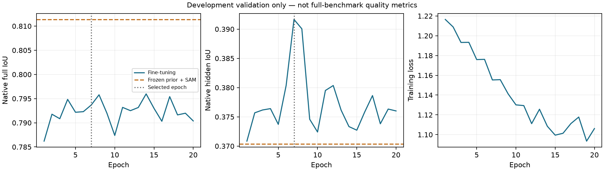

# Shape prior trained with SAM masks: validation development

All 20 fine-tuning epochs completed. The fixed native hidden-IoU selection rule
chose epoch **7**. Independent GPU checkpoint replay and local
native-mask/statistical replay passed for all 1,264 validation objects across
217 images. This is exploratory validation evidence. The active >=3% requirement
on CLIP, LPIPS, VGG Feature Similarity and SSIM remains unassessed for this model.

| Native image-mean metric | Frozen prior, SAM input | Fine-tuned prior, SAM input | Change (IoU percentage points) | Paired 95% interval (points) | Relative change |
| --- | ---: | ---: | ---: | ---: | ---: |
| Full IoU | 0.811374 | 0.793666 | -1.771 | [-2.346, -1.225] | -2.182% |
| Hidden IoU | 0.370333 | 0.391652 | +2.132 | [+0.702, +3.693] | +5.756% |

Full IoU includes all 217 images and 1,264 objects. Hidden IoU includes 177 images
and 680 objects. Both use the same native amodal truth and annotated hidden
region, including truth outside the input-defined crop. Intervals use 5,000
paired image bootstrap draws, seed 20261123. They are nominal development
intervals after validation checkpoint selection, not untouched confirmation.

The model starts from the completed v2 epoch-47 checkpoint and fine-tunes all
parameters on the same 9,494 training objects. Inputs mix 75% SAM support and
25% annotated support, with extra occlusion augmentation. True annotated
visibility defines hidden supervision. The five-channel RGB/mask model restricts
RGB to input support and predicts a shape probability mask without hard-restoring
SAM pixels. There is no Surface ranker, appearance loss, RGB correction or
combined method. The frozen v2 benchmark was not changed.

SAM was prompted with boxes derived from annotated visible support. This captures
mask-boundary errors but not GroundingDINO selection errors. No holdout or
benchmark evaluation was used for this fine-tuning. Native geometry cannot
establish the required image-quality gains or successful-output coverage.

| Job | Stage | Allocated seconds | Allocated GPU-hours |
| --- | --- | ---: | ---: |
| 45661 | training_masks | 358 | 0.397778 |
| 45662 | preflight | 74 | 0.082222 |
| 45663 | training | 920 | 1.022222 |
| 45664 | native_validation | 68 | 0.018889 |

This experiment adds **1.521111 allocated GPU-hours**.
The inherited v2 training cost and preceding SAM diagnostic are separate costs;
the total above is not the complete research cost. All listed jobs completed
with exit 0:0. Checkpoint, source snapshots, native masks, training-mask inventory
and receipts are recovered under `../recovered/` and `../training/best.pt`.

Selected checkpoint SHA-256: `3bb1a47ddd952824a960fb82867159c366c1c3e4a53a53bab1e06585adbd64a9`.
See `../native-replay.json`, `../native-export.json`, `../allocation-cost.json`,
and `../../shape-validation-sam-20261123/REPORT.md` for the original diagnostic.
