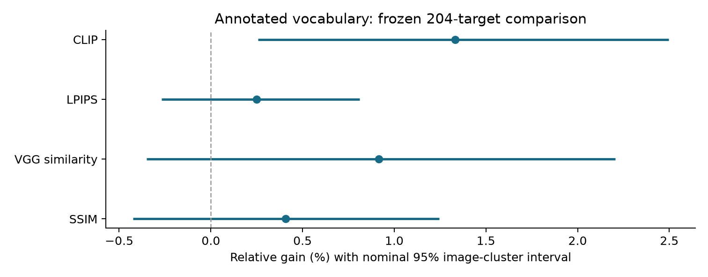
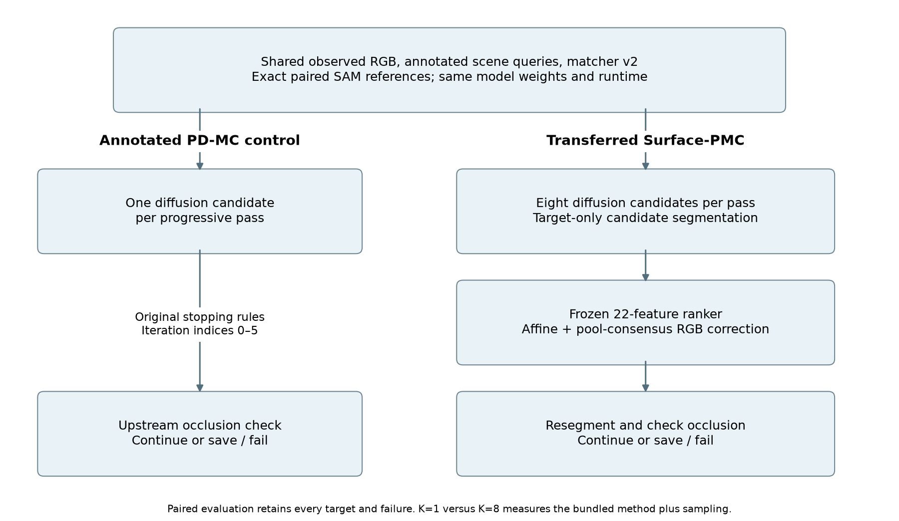
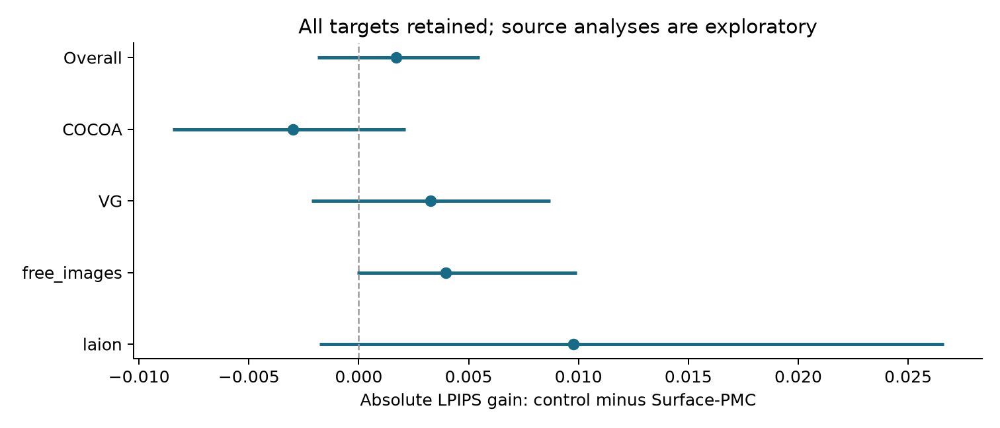
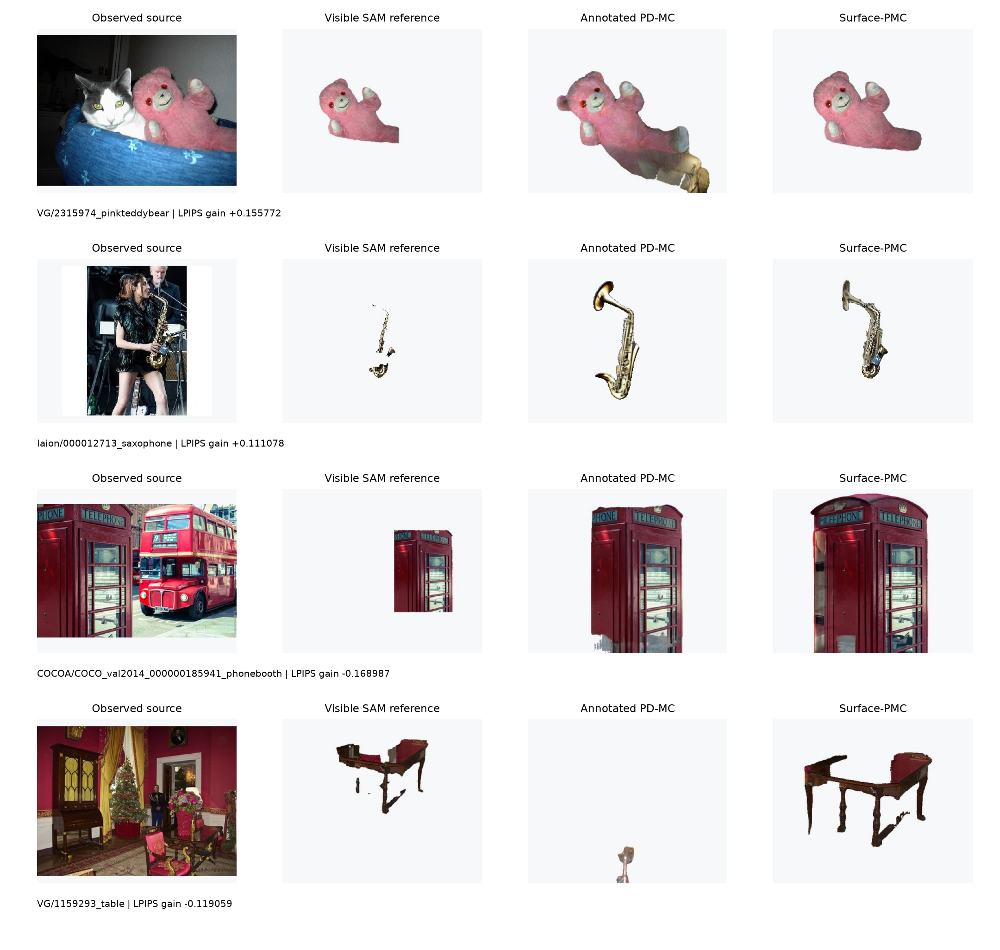

# Surface-PMC on annotated vocabulary

The primary LPIPS result is inconclusive: relative gain +0.250%, nominal 95% interval [-0.269, +0.810]%.

Completed frozen transfer experiment: 204 targets from 192 source images, with every failure retained. Both arms use annotated detector vocabulary, semantic matcher v2, identical newly frozen SAM references and the same runtime. This cohort is separate from the longer 2,565-target continuation.

[PDF](REPORT.pdf) · [All 204 cases](gallery.html) · [Paired CSV](paired_records.csv) · [Audit](audit.json)

## Frozen primary and secondary results

| Metric | Control | Surface | Relative gain | Nominal 95% interval | Paired n |
| --- | --- | --- | --- | --- | --- |
| CLIP | 28.072684 | 28.446768 | +1.333% | [+0.258, +2.496]% | 87 |
| LPIPS | 0.685276 | 0.683564 | +0.250% | [-0.269, +0.810]% | 204 |
| VGG similarity | 0.281690 | 0.284273 | +0.917% | [-0.350, +2.205]% | 204 |
| SSIM | 0.354982 | 0.356430 | +0.408% | [-0.426, +1.247]% | 204 |

For LPIPS, d_i = control_i − surface_i; for similarity metrics, d_i = surface_i − control_i. Absolute gain = mean(d_i); relative gain = 100 mean(d_i) / |mean(control_i)|. Nominal 95% percentile intervals use 5,000 source-stratified image-cluster resamples, keeping every target from each sampled image. LPIPS is the sole primary endpoint; secondary and source intervals are exploratory and not multiplicity-adjusted. LPIPS failures score 1; VGG/SSIM failures score 0. CLIP is paired only on shared successes, with no invented failure score.

## Research question and method

Research question: does the existing corrected, eight-candidate progressive Surface-PMC method improve the team’s annotated-vocabulary baseline? The generator and feature networks remain pretrained. The 22-feature ridge selector transfers unchanged from the final 10 November method. No new training or tuning was performed. The historical selector fit used 183 development images with artificial occlusion. The complete derivation and exact metric operations are in METHODS.md.

At each progressive pass, eight candidates use seed slots 11, 22, 33, 44, 55, 66, 77, 88. Their actual seeds are SHA256(surface-progressive-v1:target_seed:iteration:candidate_seed), interpreted from the first eight little-endian bytes modulo 2^63−1. The original observed target pixels anchor surface features; generated pixels never become new observations. Initial detection and progressive stopping use annotated scene vocabulary; candidate masks use the original target-only query.

Selection equation: z[k,j] = (impute(f[k,j], median[j]) − center[j]) / scale[j]; score[k] = Σ_j coefficient[j] z[k,j]; k* = argmin over valid candidates score[k]. If all eight candidates are invalid, the frozen fallback is candidate zero. The selector uses boundary/color/texture, preservation, expansion, consensus, mask disagreement, observed perceptual/deep features and category-text cosine. CLIP is therefore an explicit selection feature, not an independent selector-blind endpoint.

After selection scoring, each candidate receives the frozen observation-anchored affine correction (strength 1, bounded RGB shift 32, fitted channel slopes clipped to [0.8,1.25]) and low-frequency pool-consensus correction (strength 0.5, Gaussian sigma 4, minimum mask agreement 0.5). Original visible pixels are restored before native JPEG serialization; final JPEG pixels may differ. Candidate generation, selection, correction and altered progressive trajectories form one combined intervention.

$$z_{kj} = (\operatorname{impute}(f_{kj},m_j)-\mu_j)/\sigma_j,\qquad k^* = \arg\min_{k\in\mathcal V}\sum_{j=1}^{22} w_j z_{kj}.$$

[Full-precision frozen parameters](ranker-parameters.csv) · [Mathematical methods and training derivation](METHODS.md) · [Method equations (PDF)](method-equations.pdf) · [Statistical equations (PDF)](analysis-equations.pdf).

The cohort was selected by a pre-generation source-stratified image hash rule, retaining all targets of selected images: VG 107 images/109 targets, COCOA 58/67, free_images 14/14, LAION 13/14. All 477 previous controlled-study images were excluded by identity/source bytes; decoded/thumbnail checks rejected one near-copy before generation. The final cohort has no flagged prior-image overlaps. This screen cannot exclude every transformed duplicate.

## Reference-runtime amendment

Protocol amendment: the original historical-reference attempts failed an exact SAM check. An isolated probe reproduced one changed mask pixel, which changes five eroded alpha pixels. The fresh control generated new references, copied with hashes before Surface-PMC inference; its exact-mask and paired-reference checks remain mandatory. Historical attempts and original freezes are preserved. The reason for the numerical drift is not isolated. Completed cohort audit found 1 historical/current mask changes, totaling 1 changed pixels, with 0 changed crop geometries.

[Exact amendment and failed-attempt lineage](evidence/SURFACE_ANNOTATED_REFERENCE_AMENDMENT_20261112.md)

## Coverage and source sensitivity

Annotated control saved 87/204 outputs, with 117 failures; Surface-PMC saved 87/204, with 117 failures. Shared successes: 87; recovered: 0; lost: 0. A successful record means a saved completion, not verified hidden geometry or visual completeness. Iteration-limited saved outputs: control 5, Surface-PMC 7. The unchanged inclusive maximum of 5 permits six progressive passes. Targets that never reached surface sampling: query_mask_too_small: 9; multiple_distinct_instances: 47; label_not_matched: 27; no_occlusion_detected: 34. These upstream gates account for all 117 shared failures in this cohort. Changing candidate selection inside a pass cannot affect a target that never enters that pass. On the shared-success diagnostic, LPIPS relative gain is +1.532% with interval [-1.599, +4.870]% (n=87); this conditional result does not replace the 204-target primary.

| Source | Targets | Control saved | Surface saved | LPIPS gain | 95% interval |
| --- | --- | --- | --- | --- | --- |
| COCOA | 67 | 28 | 28 | -0.424% | [-1.227, +0.296]% |
| VG | 109 | 49 | 49 | +0.500% | [-0.327, +1.365]% |
| free_images | 14 | 6 | 6 | +0.580% | [-0.009, +1.610]% |
| laion | 14 | 4 | 4 | +1.211% | [-0.218, +3.720]% |

Exact decomposition of the all-target absolute LPIPS gain: both_failed +0.00000000; shared_success +0.00171193. Each contribution uses the same 204-target denominator. Shared-success analysis is a diagnostic and does not replace the failure-inclusive primary.

Surface-PMC logged 144 progressive candidate pools and 1152 candidate images, including 0 all-invalid fallback decisions. Both runs requested four Quadro RTX 6000 GPUs and four workers. The control uses K=1 and the method K=8: the comparison measures method plus extra sampling, not the selector’s isolated effect at equal compute. Allocation wall times and job states are preserved in evidence/job-status.json. Cohort allocation totals: baseline-cohort job 39486, 00:24:00 wall time, 1.600 reserved GPU-hours; surface-cohort job 39487, 01:49:34 wall time, 7.304 reserved GPU-hours. Reserved GPU-hours include idle/scoring/verification time and are not measured GPU utilization. Failed historical attempts and separate smoke/diagnostic allocations are additional costs.

## Fixed final-pool diagnostic

The secondary diagnostic scores all eight saved raw candidates from each successful final Surface-PMC pass, retaining the corrected final mask, native crop/JPEG serialization, earlier trajectory and failures. It compares the frozen raw choice against uniform expectation over all candidates, uniform over valid candidates, first-seed candidate and category-text selection. Corrected versus selected raw isolates the final RGB correction under these fixed conditions.

| Contrast | Metric | Relative gain | 95% interval | n |
| --- | --- | --- | --- | --- |
| frozen raw vs uniform raw | CLIP | +0.451% | [+0.105, +0.798]% | 87 |
| frozen raw vs uniform raw | LPIPS | -0.007% | [-0.033, +0.020]% | 204 |
| frozen raw vs uniform raw | VGG similarity | +0.091% | [-0.110, +0.294]% | 204 |
| frozen raw vs uniform raw | SSIM | -0.004% | [-0.064, +0.050]% | 204 |
| frozen raw vs uniform valid | CLIP | +0.433% | [+0.088, +0.780]% | 87 |
| frozen raw vs uniform valid | LPIPS | -0.006% | [-0.032, +0.021]% | 204 |
| frozen raw vs uniform valid | VGG similarity | +0.095% | [-0.106, +0.298]% | 204 |
| frozen raw vs uniform valid | SSIM | -0.002% | [-0.063, +0.051]% | 204 |
| frozen raw vs first raw | CLIP | +0.222% | [-0.193, +0.628]% | 87 |
| frozen raw vs first raw | LPIPS | -0.000% | [-0.029, +0.029]% | 204 |
| frozen raw vs first raw | VGG similarity | +0.188% | [-0.007, +0.382]% | 204 |
| frozen raw vs first raw | SSIM | +0.025% | [-0.024, +0.081]% | 204 |
| frozen raw vs semantic only | CLIP | -0.129% | [-0.476, +0.224]% | 87 |
| frozen raw vs semantic only | LPIPS | -0.002% | [-0.027, +0.021]% | 204 |
| frozen raw vs semantic only | VGG similarity | +0.071% | [-0.115, +0.267]% | 204 |
| frozen raw vs semantic only | SSIM | +0.014% | [-0.027, +0.061]% | 204 |
| corrected vs frozen raw | CLIP | -0.425% | [-0.818, -0.018]% | 87 |
| corrected vs frozen raw | LPIPS | +0.306% | [+0.176, +0.471]% | 204 |
| corrected vs frozen raw | VGG similarity | +0.652% | [+0.376, +0.951]% | 204 |
| corrected vs frozen raw | SSIM | +0.579% | [+0.186, +0.989]% | 204 |
| Metric-specific oracle vs control | CLIP | +3.409% | [+2.244, +4.713]% | 87 |
| Metric-specific oracle vs control | LPIPS | +0.114% | [-0.371, +0.644]% | 204 |
| Metric-specific oracle vs control | VGG similarity | +1.428% | [+0.153, +2.740]% | 204 |
| Metric-specific oracle vs control | SSIM | +0.135% | [-0.534, +0.805]% | 204 |

[Complete independent pool audit, including individual oracle bounds](pool-audit.json)

At fixed final masks and earlier trajectories, frozen raw selection versus uniform raw choice gives LPIPS -0.007% ([-0.033, +0.020]%) and CLIP +0.451% ([+0.105, +0.798]%). Final RGB correction versus the selected raw image gives LPIPS +0.306% ([+0.176, +0.471]%) and CLIP -0.425% ([-0.818, -0.018]%). The per-metric raw LPIPS oracle versus the annotated control gives +0.114% ([-0.371, +0.644]%). All intervals here are nominal exploratory 95% intervals. The raw-pool oracle bounds only these saved raw candidates at fixed masks/trajectories; corrected RGB is outside that candidate set. These observations do not isolate the effect of selection at earlier progressive steps.

This diagnostic does not rerun progressive random trajectories. Fixed corrected masks may favor the selected trajectory. Reference-informed oracle choices differ by metric and are only individual upper bounds; they are not deployable selectors or a jointly attainable score vector. No tuning uses these results.

## Evidence and interpretation

Independent local audit reproduced all 204 target records, reference/input identities, failure counts and paired intervals; replayed 144 selector decisions from logged observable features and exact corrected RGB at saved candidate resolution; and checked 2736 pool-artifact hashes. Local feature extraction and neural metrics were not rerun. The diagnostic additionally replayed 696 native candidate derivations; maximum original-score replay drift was 1.79e-07. Repeated eight-target GPU smoke: 4 native RGB/mask artifact hashes match the cohort, with 0 targets showing status or native-artifact differences.

The companion gallery contains every frozen target, including all failed targets. Filters expose metric gains, losses and coverage states; no recovered or lost successes were observed in this cohort. The displayed image crops retain each method’s own geometry. The largest metric gains and losses are convenience views, not a blinded human evaluation or a representative qualitative sample.

[Exact example-selection rule and image hashes](qualitative-examples.json). These metric-selected extremes are not representative prevalence estimates.

Post-hoc inspection of these four metric-selected examples: VG/2315974_pinkteddybear: control 59,688 versus Surface-PMC 35,646 foreground pixels; laion/000012713_saxophone: control 5,481 versus Surface-PMC 4,133 foreground pixels; COCOA/COCO_val2014_000000185941_phonebooth: control 144,334 versus Surface-PMC 194,128 foreground pixels; VG/1159293_table: control 2,120 versus Surface-PMC 24,581 foreground pixels. The native widths, heights, offsets and image hashes are retained in qualitative-examples.json. The teddy and saxophone gains accompany smaller masks; the phonebooth and table losses accompany larger masks. The table control retains only a small fragment, while Surface-PMC retains more of the table yet scores worse. These observations illustrate why visible-reference scores cannot certify hidden-shape accuracy. They are assistant visual observations, not blinded human ratings, and establish no cohort-wide prevalence or causal effect.

Natural hidden RGB is unavailable. SAM-visible-reference appearance metrics measure a different quantity from true hidden-surface reconstruction. More candidates, RGB correction, mask changes and progressive path changes are bundled. A point gain or nonzero confidence interval does not prove amodal shape accuracy, causal selector benefit at equal compute, or human preference. There is no predeclared 3% pass threshold for this annotated study. Observed LPIPS features share a metric family with the primary endpoint; historical fitting also used perceptual and CLIP objectives. These scores are not wholly independent perceptual assessors of the selector. The bootstrap conditions on the frozen model and candidate seeds; it does not include retraining or seed-to-seed uncertainty.

## Full-benchmark continuation

The full 2,565-target annotated control and Surface-PMC continuation are separate operational benchmark runs. They include previously used training/development images and are not wholly unseen generalization. The frozen unseen-image inventory supports a later sensitivity analysis. Only complete runs passing provenance verification can be registered. Valid longer inference remains running beyond the interactive work window.

[Exact continuation jobs and recovery instructions](evidence/SURFACE_ANNOTATED_CONTINUATION_20261112.md).

The completed cohort does not establish a primary improvement. Preserve this result and await the full operational comparison; do not retune against the frozen cohort or replace its denominator.
