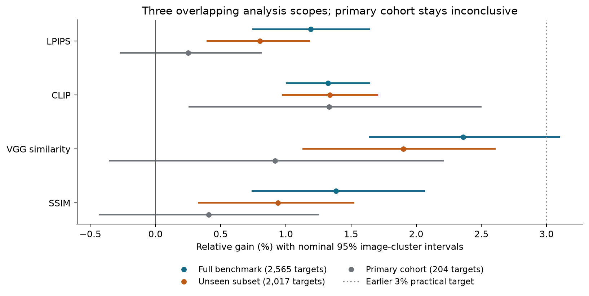

# Annotated Surface-PMC: completed full benchmark

14 November 2026. This completes the frozen 12 November continuation. Both arms use annotated vocabulary, matched fresh SAM references, and the existing pretrained generator. No new training, fitting, retuning, or inference was launched for this review.

**The full operational benchmark improves LPIPS by 1.191% [+0.749%, +1.641%]. The earlier 3% practical target is not met.** The independent 204-target primary cohort remains inconclusive; the larger full benchmark does not replace that primary test.

The full comparison, provenance verification, registration and independent cluster audit completed on 13 November. Local checksum, provenance, registry, selector and statistical replay now pass. This is evidence of a modest gain under the specified visible-reference protocol, not proof of correct unseen surfaces.

## Full operational comparison

2,565 targets from 2,379 images. Positive relative gain is favorable. LPIPS, VGG similarity and SSIM include all failures with the original penalties; CLIP uses only paired shared successes.

| Metric | Control | Surface-PMC | Relative gain | Nominal 95% interval | n |
| --- | ---: | ---: | ---: | --- | ---: |
| LPIPS (lower is better) | 0.614408 | 0.607088 | +1.191% | [+0.749%, +1.641%] | 2565 |
| CLIP (shared successes) | 28.168627 | 28.541179 | +1.323% | [+1.007%, +1.641%] | 1387 |
| VGG feature similarity | 0.349608 | 0.357859 | +2.360% | [+1.644%, +3.100%] | 2565 |
| SSIM | 0.445624 | 0.451793 | +1.384% | [+0.744%, +2.061%] | 2565 |

Absolute LPIPS reduction: 0.00732015, nominal 95% interval [+0.00462288, +0.01010539]. Full results include images previously used in controlled development or training; this is an operational benchmark comparison.

## Unseen-image sensitivity and the original primary cohort

The frozen unseen inventory contains 2,017 targets from 1,900 images. It excludes prior images by identity and source bytes. Only the original primary cohort received the exhaustive near-copy screen. These sensitivity intervals are nominal and exploratory.

| Metric | Control | Surface-PMC | Relative gain | Nominal 95% interval | n |
| --- | ---: | ---: | ---: | --- | ---: |
| LPIPS (lower is better) | 0.642324 | 0.637177 | +0.801% | [+0.396%, +1.179%] | 2017 |
| CLIP (shared successes) | 28.161953 | 28.538611 | +1.337% | [+0.975%, +1.702%] | 1011 |
| VGG feature similarity | 0.322467 | 0.328597 | +1.901% | [+1.134%, +2.604%] | 2017 |
| SSIM | 0.413941 | 0.417825 | +0.938% | [+0.331%, +1.521%] | 2017 |

The original 192-image / 204-target primary cohort has LPIPS +0.250% [-0.269%, +0.810%], with 87 saved outputs in each arm. It remains inconclusive, including after the full results are available. Full, unseen and primary analyses overlap; they are not three independent replications.

## Coverage, failures and source-level results

The control saves 1,394 outputs and retains 1,171 failures; Surface-PMC saves 1,399 and retains 1,166 failures. There are 1,387 shared successes, 12 gained outputs, 7 lost outputs and 1,159 failures in both arms. The net coverage change is +5 targets (+0.195 percentage points). Iteration-capped saved outputs change from 209 to 199. A saved output or non-cap stop does not establish complete or correct hidden geometry.

| Source | Targets | Control saved | Surface saved | LPIPS gain | 95% interval |
| --- | ---: | ---: | ---: | ---: | --- |
| COCOA | 845 | 441 | 444 | +0.984% | [+0.035%, +2.041%] |
| VG | 1294 | 726 | 729 | +1.559% | [+1.123%, +2.048%] |
| free_images | 249 | 132 | 132 | +1.536% | [+0.781%, +2.343%] |
| laion | 177 | 95 | 94 | -0.931% | [-3.606%, +1.364%] |

Source intervals are post-hoc descriptive and unadjusted for multiple comparisons. They do not establish category-wide or causal mechanisms.

| Failure reason | Control | Surface-PMC |
| --- | ---: | ---: |
| completion_not_detected | 15 | 10 |
| label_not_matched | 232 | 232 |
| multiple_distinct_instances | 329 | 329 |
| no_detections | 2 | 2 |
| no_occlusion_detected | 484 | 484 |
| query_mask_too_small | 108 | 108 |
| unknown_detected_class | 1 | 1 |

Of the 1,166 Surface-PMC failures, 1,156 stop before candidate sampling. The current downstream selector does not run on these cases. No-occlusion decisions, ambiguous instances and unmatched labels dominate this upstream bottleneck.

The diagnostic decomposition below partitions the full absolute LPIPS difference using the full 2,565-target denominator. These contributions add to the full difference; they are descriptive, not isolated causal effects.

| Transition group | Targets | Absolute LPIPS contribution |
| --- | ---: | ---: |
| shared success | 1387 | +0.00635123 |
| gained | 12 | +0.00288955 |
| lost | 7 | -0.00192064 |
| both failed | 1159 | +0.00000000 |

Conditional LPIPS on shared successes improves 4.044% [+2.972%, +5.125%]. Its denominator differs from the all-target endpoint. The overall unpaired CLIP means are 28.159741 (control n=1,394) and 28.533665 (Surface-PMC n=1,399); the paired CLIP estimate in the results table uses 1,387 shared successes.

## Method, estimand and uncertainty

The intervention bundles K=8 candidate generation, the unchanged 22-feature ridge selector, observation anchoring, affine correction and pool consensus inside progressive completion. The control uses K=1. Annotated scene queries are present in both arms; candidate masks retain target-only segmentation. The selector parameters and corrections match the historical frozen method.

For LPIPS, Δ = (1/N) Σᵢ(Lcontrol,i − Lsurface,i), and relative gain = 100 × Δ / mean(Lcontrol). Failed completions have LPIPS=1, VGG similarity=0 and SSIM=0. CLIP has no invented failure score. Higher-is-better metrics reverse the difference direction. The bootstrap resamples source images within each dataset source, retains all targets belonging to an image, and uses 5,000 draws with seed 20261110. Intervals are percentile 2.5%–97.5%; secondary/source analyses have no multiplicity adjustment.

Fresh control references were copied exactly before Surface-PMC execution. Paired input/reference hashes, seeds, model/checkpoint configuration, metric operations and installed packages match. The prior one-pixel historical-reference drift and its amendment remain documented. The comparison measures the complete intervention plus extra sampling; it cannot isolate selection from correction or increased compute. See [the preserved mathematical methods](evidence/METHODS.md).

## Compute and completed jobs

2,847 saved candidate pools contain 22,776 candidate images, with 9 all-invalid fallbacks. These counts describe recorded pools, not any discarded work before timeout.

| Arm | Jobs including cohort | Allocation wall hours | Reserved GPU-hours |
| --- | --- | ---: | ---: |
| baseline | 39486, 39488 | 6.149 | 24.597 |
| surface | 39487, 39490, 39491 | 29.101 | 116.406 |

The allocation-time ratio is 4.733×. Both arms used four Quadro RTX 6000 GPUs and four workers. Cohort work is counted because its results were reused in the full run. Reserved GPU-hours include setup, scoring, verification and idle worker time; they are not measured utilization or pure model latency. Failed historical-reference attempts, smoke, the cohort pool diagnostic, CPU audits and queue time are excluded from this two-arm comparison.

Surface job 39490 reached its 24-hour limit. The pre-submitted unchanged continuation 39491 completed. Finalizer 39492 verified both complete runs and registered them; independent full/unseen audit 39497 and metadata export 39495 completed. No job remains to resume in this study. Accounting timestamps in the raw receipt use cluster local time; elapsed seconds are used for cost.

## Evidence checks and limitations

All 16,197 metadata members match independent remote SHA-256 values. Local execution provenance passes for both arms, all 408 original cohort result hashes are preserved, and 5,538 historical snapshot-to-result hashes agree. All 2,847 stored-feature selector choices and losses replay, including seeds and decision hashes. Full and unseen means, denominators, transitions and bootstrap intervals reproduce the separate cluster audit within 1e-10. Both registry entries match execution, protocol, summary and metric identities.

The full native PNGs remain on the cluster, where full artifact and provenance verification passed. This local review does not rerun the neural metrics, feature extraction or full RGB-correction replay. The primary cohort already has separate native recovery and exact local/cluster correction replay. These scopes must not be conflated.

Visible-reference appearance scores and CLIP do not establish natural hidden RGB accuracy, amodal shape correctness or human preference. Changed masks, crop geometry and progressive trajectories can affect appearance scores. The cohort-only fixed-pool diagnostic does not identify the selector contribution over the full progressive run.

## Research decision and next experiment

Record Surface-PMC as a modest operational improvement under this protocol, with the original primary transfer test still inconclusive and the earlier 3% practical target unmet. The approximately 4.73× allocation cost does not justify automatically replacing the annotated PD-MC operational baseline. The lower iteration-cap count (209 to 199) is descriptive and does not establish hidden-object correctness.

The next mechanism experiment should use a new frozen design with equal-budget progressive random selection and a correction-only ablation, plus independent geometry or blinded human assessment. Existing controlled, cohort and full outcomes must be treated as inspected data for any future tuning. No such experiment has been launched by this continuation.

## Files and reproduction

[Local audit](audit.json), [all 2,565 paired targets](paired-records.csv), [selector replay](decision-replay.json), [original full comparison](evidence/comparison.json), [cluster audit](evidence/independent-audit.json), [primary cohort PDF](evidence/PRIMARY_COHORT_REPORT.pdf), and [job/registry recovery receipt](remote-evidence/receipt.json) are retained beside this report.

From the original workspace, reproduce the metadata review with `python scripts/review_annotated_full.py` and rebuild this report with `python scripts/build_annotated_full_report.py`. These commands preserve the original full comparison and remote audit. The portable package contains the independently hashed full metadata archive and receipts; native full PNGs are outside that package.
