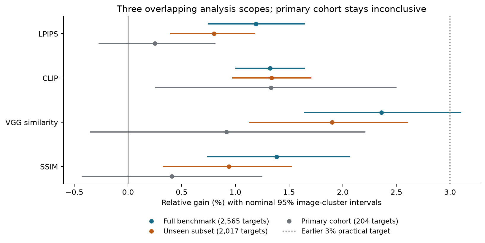
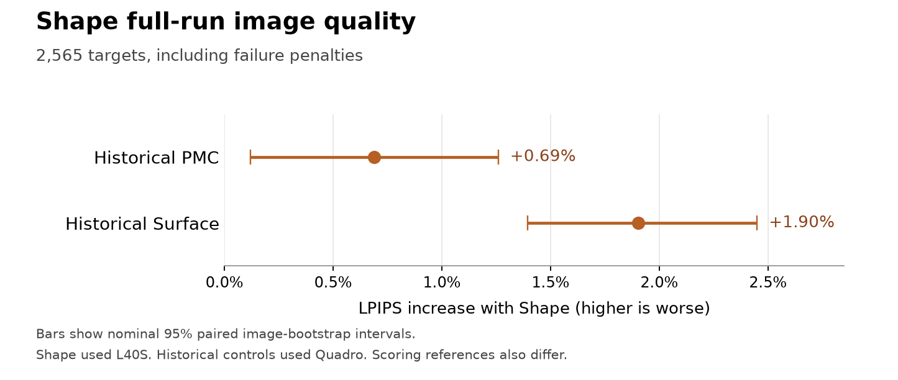

# Research results through 24 November 2026

The repository includes completed results and the latest recovered diagnostics.
**At least 3% improvement on all four full-benchmark metrics has not been achieved.**
The frozen v2 run has 222/2,565 terminal records (112 successful, 110 failed).
Its full scoring, verification/registration, native audit and final accounting
are still pending. The latest included cluster observation is
[24 November, 12:35 UTC](../output/shape-cluster-restored-20261124/restoration.json):
the preserved continuation chains wait for maintenance ending 25 November,
13:00 UTC. This is a dated snapshot, not a live job monitor.

## Completed full benchmarks

Positive relative gains favor the method. LPIPS, VGG feature similarity and
SSIM include every target with the original failure penalties. CLIP uses shared
scored successes; its denominator is shown separately in each report.

| Study | Targets | Saved outputs | CLIP gain | LPIPS gain | VGG gain | SSIM gain |
| --- | ---: | ---: | ---: | ---: | ---: | ---: |
| Annotated Surface-PMC vs annotated PD-MC | 2,565 | 1,399 vs 1,394 | +1.323% | +1.191% | +2.360% | +1.384% |
| Shape v1 vs historical annotated PD-MC | 2,565 | 1,393 vs 1,394 | +0.430% | -0.689% | -1.237% | -0.618% |

Surface-PMC used the same Quadro GPU type and matching references as its control.
Its LPIPS nominal 95% interval is [+0.749%, +1.641%], with +0.801% on the frozen
2,017-target unseen subset. CLIP covers 1,387 shared successes. The original
204-target primary result remains inconclusive. Allocated GPU-hours were
116.406 versus 24.597 (4.733 times the control).

- [Surface full report](../output/surface-annotated-full-review-20261114/REPORT.md)
  and [PDF](../output/surface-annotated-full-review-20261114/REPORT.pdf)
- [All 2,565 paired records](../output/surface-annotated-full-review-20261114/paired-records.csv),
  [audit](../output/surface-annotated-full-review-20261114/audit.json), and
  [study interpretation](../docs/SURFACE_ANNOTATED_FULL_RESULTS_20261114.md)

Shape v1 ran on L40S and reuses historical Quadro controls. Hardware, sampling
wrappers and some reference masks differ; the report includes matching-reference
sensitivities. Its full LPIPS interval is [-1.259%, -0.118%], unseen LPIPS is
-0.935%, and CLIP covers 1,379 shared successes. Native amodal IoU on all 321
matched targets is 0.454330 versus 0.462682, retaining failures at zero.
Shape used 109.571 allocated L40S GPU-hours, including the cohort and interrupted
allocations. Controlled artificial-occlusion gains do not establish natural
full-benchmark gains. The combined method's completed cohort is reported
separately; no completed combined full result is asserted by this snapshot.

- [Shape research report](../output/shape-20261121/REPORT.md),
  [full estimates and intervals](../output/shape-20261121/shape-full-summary.json),
  [all paired targets](../output/shape-20261121/shape-full-pairs.json), and
  [registered per-target scores](../output/shape-20261121/progressive-l40s/shape/per_target.csv)
- [Full metadata replay](../output/shape-20261121/shape-full-metadata-replay.json),
  [native geometry replay](../output/shape-20261121/shape-full-cocoa-native-replay.json),
  and [final reconciliation/accounting](../output/shape-20261121/shape-full-local-reconciliation.json)





## Frozen v2: completed training, incomplete benchmark

Training completed 60 epochs on four Quadro GPUs; validation selected epoch 47.
Training cost was 2.662222 allocated GPU-hours. Native annotated-input geometry
is distinct from geometry using SAM input and from benchmark appearance scores.

| Native shape-prior split | Objects / images | Full IoU | Hidden IoU |
| --- | ---: | ---: | ---: |
| Validation | 1,264 / 217 | 0.888731 | 0.436647 |
| Reserved holdout | 1,183 / 195 | 0.874936 | 0.421346 |

The frozen policy was preserved after reading holdout. The real four-GPU smoke
passed native replay of 9 pools / 72 candidates / 0 fallbacks. The later fixed
193-target VG prefix diagnostic reports CLIP +1.520%, LPIPS +0.882%, VGG +3.142%
and SSIM +0.605%, with 96 saved outputs in each arm. This nonrandom prefix is
not the full benchmark and does not meet the four-metric goal. Full completion
must preserve all 2,565 targets, failure penalties, CLIP coverage, the historical
2,017-target unseen subset and 321-target native geometry.

- [Training verification](../output/shape-v2-slurm-20261123/training-recovery-verification.json),
  [geometry verification](../output/shape-v2-slurm-20261123/geometry-recovery-verification.json),
  and [smoke replay](../output/shape-v2-slurm-20261123/smoke-native-replay.json)
- [Partial quality report](../output/shape-v2-slurm-20261123/snapshot-quality-recovery/REPORT.md),
  [per-target scores and intervals](../output/shape-v2-slurm-20261123/snapshot-quality-recovery/snapshot-quality-45665/result.json),
  and [local replay](../output/shape-v2-slurm-20261123/snapshot-quality-recovery/replay.json)
- [Retained-record continuation check](../output/shape-v2-slurm-20261123/maintenance-continuation-replay.json)
  and [dated recovery](../output/shape-v2-slurm-20261123/latest-recovery.json)

Best checkpoint SHA-256:
`f3caa75ac40f901a7595fffa2c199221b83e7fe5a57192f34e2b2317ffe937b7`.
Policy freeze SHA-256:
`6078e500c236095a537000d2d3f90838253ab7542d39c69d0fafe67db150523b`.

## Completed validation diagnostics

These are iterative studies on reused validation data, not untouched confirmation
or full-benchmark gains. They do not change the frozen v2 experiment.

- [SAM robustness fine-tuning](../output/shape-sam-robustness-20261123/report/REPORT.md):
  epoch 7 improves hidden IoU from 0.370333 to 0.391652, while full IoU falls
  from 0.811374 to 0.793666. The separate
  [support-union diagnostic](../output/shape-sam-robustness-20261123/support-clamp-ablation/REPORT.md)
  does not resolve the full-shape regression.
- [Local probability-loss training](../output/shape-probability-workers4-20261123/report/REPORT.md):
  all 20 epochs complete; epoch zero wins. The
  [1,264-object native replay](../output/shape-probability-workers4-20261123/native-replay.json)
  confirms no eligible new checkpoint and exact original Quadro mask agreement.
- [Fixed final-epoch offset diagnostic](../output/shape-probability-final-recovery-20261124/full-replay.md):
  none of offsets 0, 0.5, 1, 1.5 or 2 meets both unchanged geometry floors.
  [Assessment](../output/shape-probability-final-recovery-20261124/assessment.json)
  and [independent native replay](../output/shape-probability-final-recovery-20261124/full-replay.json)
  retain the negative finding; no offset or checkpoint was promoted.

## Included evidence and reproduction limits

[published-files.json](published-files.json) enumerates every included result
file with its byte count and SHA-256. Files remain at their original `output/`
paths and keep their original bytes, including dated status statements.
The index above distinguishes completed studies from earlier milestones.

```bash
python scripts/verify_published_results.py
bash scripts/check.sh
```

The first command verifies the published files, not neural inference or the
entire historical experiment. The CPU suite tests source behavior with fixtures.
The [publication validation receipt](validation-20261124.json) and
[complete check log](validation-20261124.txt) record 485 Python tests with 20
optional skips, six Bash regressions, CPU smoke, and source/wheel builds.
Native images, full target/selector archives, model weights and datasets remain
external. Earlier reports may link those external artifacts; the manifest is the
authoritative list of files included in Git. Full native replay requires the
original artifacts and pinned runtime described by each experiment's receipts.
Verification does not reinterpret partial results as completed experiments.
